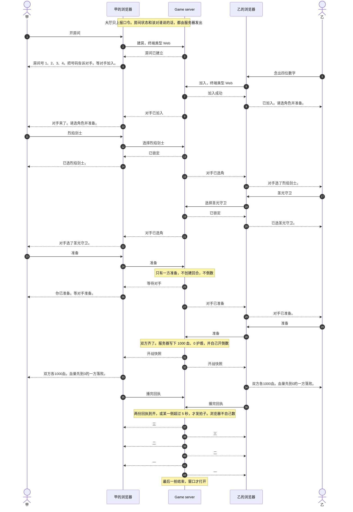
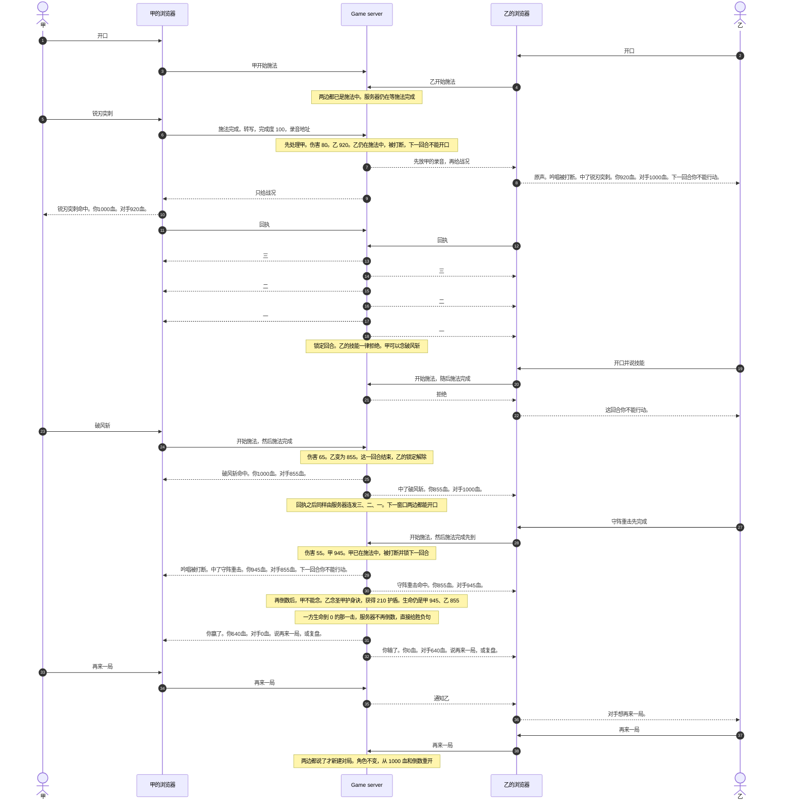
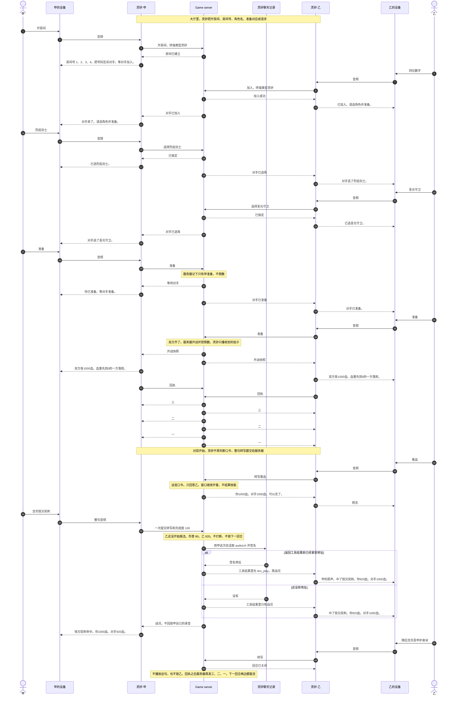
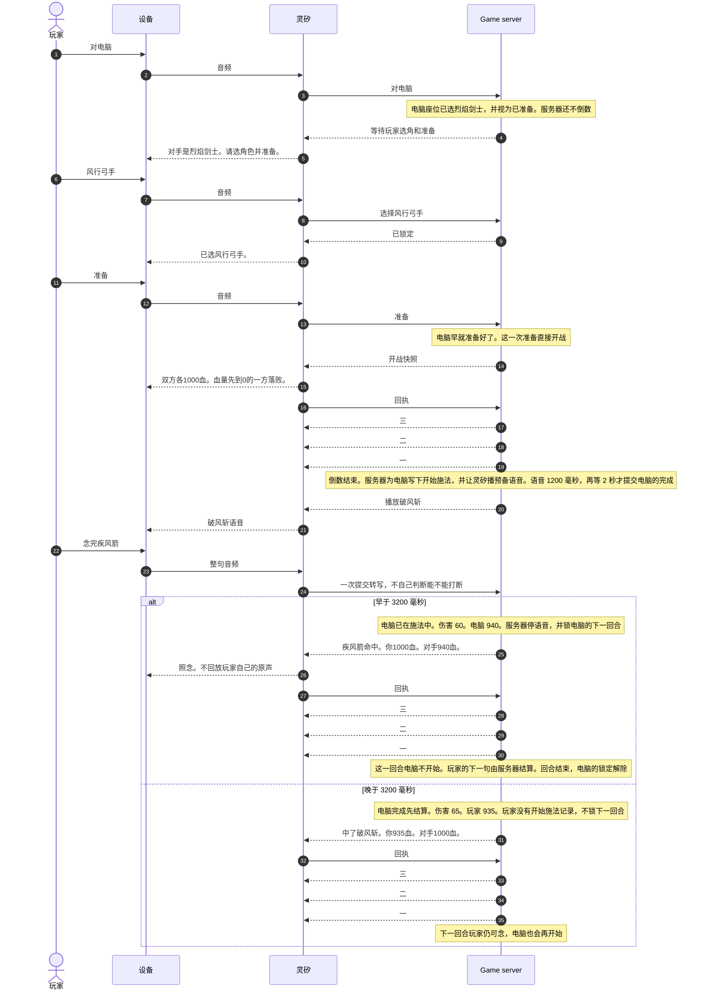
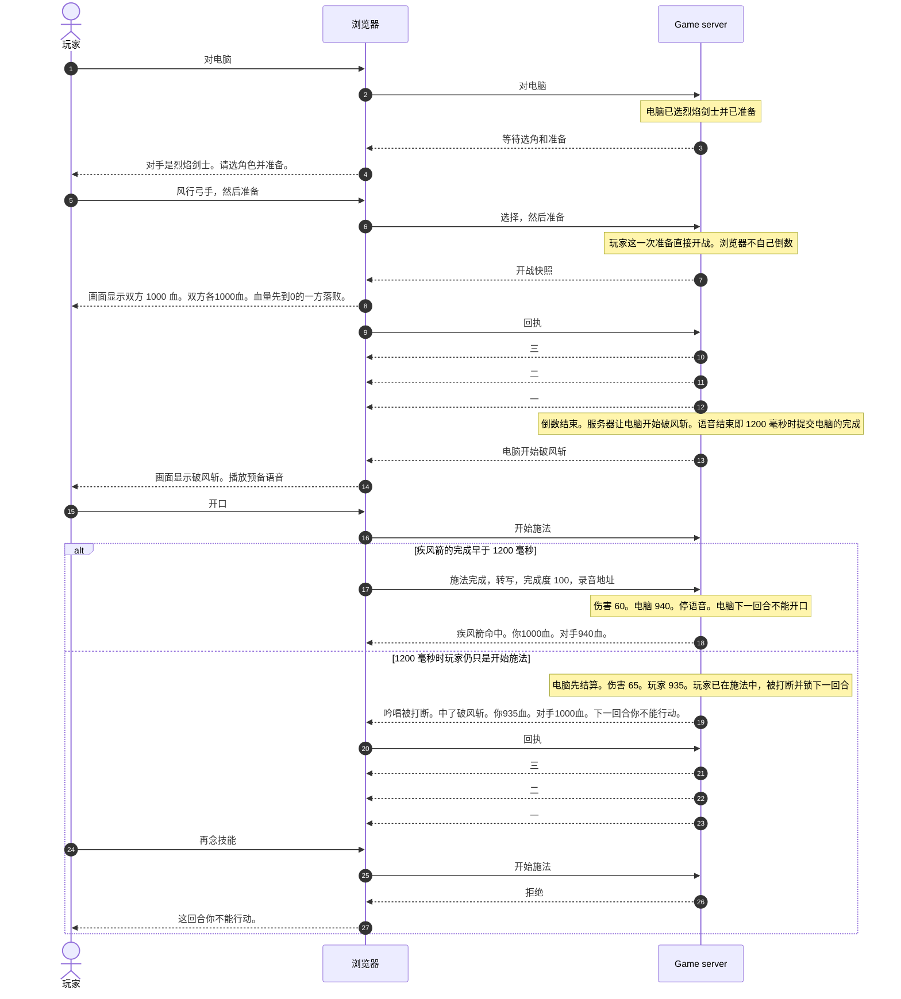
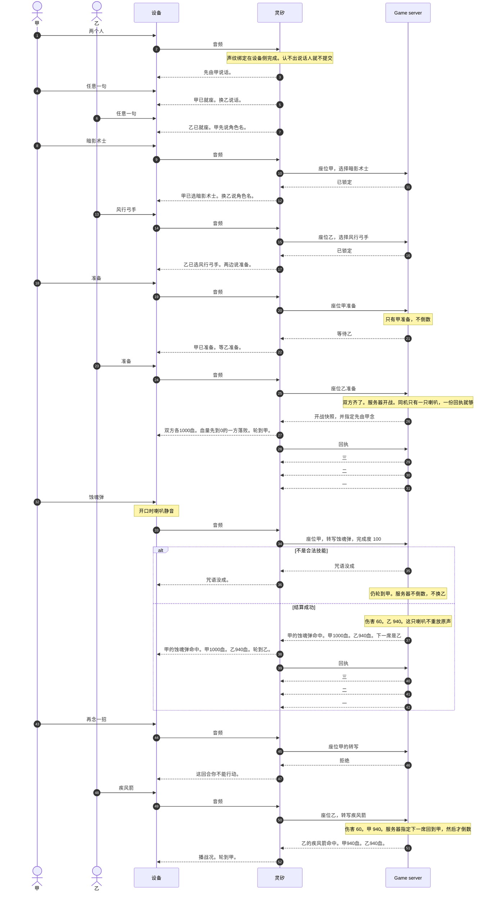

# 烈焰燎原 · 交互设计

本文规定玩家说什么、听到什么。Web
和两台灵矽各听自己视角的主持。一台灵矽上的同机双人只有一只喇叭，改用座位甲、座位乙。

| 项                         | 内容                                                |
| -------------------------- | --------------------------------------------------- |
| 产品范围                   | 见 [设计文档](./设计文档.md)                        |
| 谁赢、打多少、技能能不能放 | 见 [玩法设计](./gameplay-design.md)。本文不改变裁决 |
| 本文                       | 主持词、口令顺序、等待和收尾、声纹座位、一场时序    |

战报来自已经持久化的服务器事件。失败短句、「吟唱被打断。」「可以念了。」使用下面的原文。战况只说技能名和双方血量，不说第几回合，也不说「回合开始」「回合结束」。不使用「为您播放」一类前缀，也不把血量当成音频标题。

开战和每一击之后，终端先把这句战况播完，再向服务器回执。服务器才倒数「三。二。一。」倒数用的是服务器发出的拍子。倒数结束才能开口念技能。

对方的施法被接受，并且战况回执发出前已经拿到录音地址，就把这句原声放在战况前面，只放给对方。施法者自己不听回放。地址没到，就直接说战况，不推迟倒数。灵矽播放的是整句结束后的录音。同机轮流念，喇叭不重放任何人的原声。对电脑时，播放预先准备的咒语语音，每个汉字
400 毫秒。录音和技能语音只让人听见，不拿来判技能或伤害。

Web
上，血量在结算后立刻出现。对方技能名和原声在这次施法被接受后出现。对电脑时，倒数一结束就显示电脑技能并播放预备语音。灵矽没有画面。

---

## 1. 谁在听

| 场面             | 怎么称呼                                   |
| ---------------- | ------------------------------------------ |
| Web，一人一屏    | 己方是「你」，对方是「对手」               |
| 两台灵矽         | 各听自己的「你 / 对手」                    |
| 一台灵矽，两个人 | 全场只听一套话：座位甲、座位乙。不用「你」 |

同机示例：

```text
甲的锐刃突刺命中。甲1000血。乙920血。
```

两台设备上的同一次结算，甲那边听到「锐刃突刺命中。你1000血。对手920血。」乙那边听到「中了锐刃突刺。你920血。对手1000血。」

---

## 2. 一场里玩家听到的句子

血量用句号断开。有护盾时，加在该方血量后面。

**进入：**

```text
说角色名开始。可以练技能，对电脑，或开房间。两个人在旁边就说两个人。
```

**开战：** 先说一句，再说服务器的倒数。不念技能名单。

```text
双方各1000血。血量先到0的一方落败。三。二。一。
```

倒数结束即可开口。技能名只在玩家问「还有哪些技能」时说。

**对方这一击：**
不再另说「对手开始吟唱」。地址已经在手时，先听对方念完的原声，再听战况。没有地址就只有战况。同机听旁边那个人自己的声音。对电脑听预先准备的技能语音。

**这一击的结果：**

```text
锐刃突刺命中。你1000血。对手920血。
中了锐刃突刺。你920血。对手1000血。
圣甲护身诀。你获得210点护盾。你1000血。护盾210。对手920血。
```

治疗、破盾、净化和「下一回合无法行动」各用一句短话，然后再报双方血量。伤害被护盾完全吸收时说「被挡住」，并报剩余护盾。

**还有持续伤害或周期治疗时：**
接在这一击后面，先报来源技能名和数值，再报双方血量。没有这些结算就不另播。这一击已经分出胜负时，后面不再播。

```text
毒雨连射阵。你受到35点伤害。你965血。对手1000血。
```

数值以服务器这次结算为准。播完向服务器回执，然后听服务器倒数「三。二。一。」倒数结束即可开口。

**被打断：**
自己听到「吟唱被打断。」技能不结算。战况末尾加「下一回合你不能行动。」然后才倒数。下一回合对方可以单独念。被锁的人再念，只听到「这回合你不能行动。」该回合结束、下次倒数完，就可以直接念。

**技能没被接受：** 回合继续等。对方如果还在吟唱，不受影响。

| 原因                     | 听到                   |
| ------------------------ | ---------------------- |
| 不是标准技能名           | 「咒语没成。」         |
| 一句里有两个及以上技能名 | 「一次一道。」         |
| 这招本局已经用过         | 「这招已经用过。」     |
| 基础技能上一回合刚用过   | 「这招不能连着念。」   |
| 次数或间隔不够           | 「这招还不能再用。」   |
| 打断后的下一回合         | 「这回合你不能行动。」 |
| 本回合被限制行动         | 「这回合你不能行动。」 |

**看状态：** 领先或落后、双方生命、双方护盾、现在能不能开口。同机用甲乙的血量。

**还有哪些技能：**
只报当前还能用的技能名。玩家追问某一招，再报那一招的用法和效果。不把七招的效果一次念完。

**练习：**
不报回合号。念对时直接报完成度、技能名和该完成度下的数值。没念对时用「咒语没成。」或「一次一道。」结束练习时说「练习结束。说对电脑打一局，或开房间。」

**结束：**

```text
你赢了。你640血。对手0血。说再来一局，或复盘。
你输了。你0血。对手640血。说再来一局，或复盘。
平局。你0血。对手0血。说再来一局，或复盘。
```

同机把「你赢了」换成「甲赢了」或「乙赢了」，平局说「平局」。认输、主动离开，或断线超过
10
秒，用输赢这两句。已经进入结算的技能先算完；这次结算已经分出胜负时，听那个结果。异常结束说「这局中断了。」不报胜负。

**再来一局：**
沿用双方角色和对手。一方说了，另一方听到「对手想再来一局。」双方都说再来一局后，新建对局并开战。一方要换角色，先说角色名，再准备。

**复盘：**
先说胜负和最终血量，再说最后三击谁用了什么技能。玩家说「从头复盘」时，每一击一句，从第一击说到结束。复盘可以说第几回合，战斗播报里不说。

**10 秒内重连：**
只说一句现状，不补播中间每一击，也不报回合号。这一回合不能开口时，最后一句用「这回合你不能行动。」正在倒数就接上还没播的拍子。

```text
回来了。你800血。对手620血。可以念了。
回来了。你800血。对手620血。这回合你不能行动。
```

若这一回合不能行动，把最后一句换成「这回合你不能行动。」

---

## 3. 开口怎么对应到施法

大厅和复盘由终端匹配口令：选角、练习、对电脑、两个人、开房间、房间号、准备、再说一次、再来一局、复盘、从头复盘。

对局中不再在终端分流。灵矽把整句转写交给 Game
server，由服务器决定是口令还是施法。Game server
不重做转写。同机仍先用声纹确定座位；认不出说话人时不提交。

| 服务器收到的内容                                         | 服务器怎么处理                                               | 对方听到                                               |
| -------------------------------------------------------- | ------------------------------------------------------------ | ------------------------------------------------------ |
| 转写是看血、还有哪些技能、投降                           | 只回答说话的人。不进入施法                                   | 没有这段录音                                           |
| 转写不是口令，并且开始施法校验通过                       | 接受为施法。回执发出前拿到录音地址，才放在战况前面给对方     | 念完的原声，然后是短战况。同机不放。地址未到就只有战况 |
| 转写是合法技能                                           | 施法完成。结算或打断。战况末尾说明被打断的人下一回合不能开口 | 短战况，然后倒数                                       |
| 转写不是合法技能，或这一回合被锁定、还在倒数、被行动限制 | 拒绝。不把录音当成生效技能                                   | 不播放这句                                             |
| 同机认不出说话人                                         | 终端不提交                                                   | 「没听清是谁，请再说一遍。」                           |

练习里不发送开始施法和施法完成。练习只把整句拿去判定，并立刻念出完成度和效果。练习录音不进入对局。

练习里不发送开始施法和施法完成。练习只把整句拿去判定，并立刻念出完成度和效果。原声不进入对局。

---

## 4. 灵矽

灵矽是无屏终端。身份来自设备或会话，不由模型自己申报座位。

| 阶段 | 玩家可以做的事                                         |
| ---- | ------------------------------------------------------ |
| 大厅 | 选角、练习、对电脑、两个人、开房间、加入、准备、看技能 |
| 战场 | 念技能、看血、还有哪些技能、投降                       |
| 复盘 | 听复盘，再来一局，或换角色                             |

| 玩家说                    | 系统回应                                                                                                                                                                             |
| ------------------------- | ------------------------------------------------------------------------------------------------------------------------------------------------------------------------------------ |
| 角色名，如「烈焰剑士」    | 「已选烈焰剑士。」未拥有时说「还没有这个角色。」并再说一遍四名角色。联机时另一边听到「对手选了烈焰剑士。」                                                                           |
| 对电脑                    | 「对手是烈焰剑士。请选角色并准备。」玩家指定了对手角色，就把烈焰剑士换成那个名字。电脑此时已选角、已准备                                                                             |
| 两个人                    | 进入同机双人，开始录声纹。先说「先由甲说话。」                                                                                                                                       |
| 开始练习 / 练技能         | 未选角则先要求选角。进入练习，先报技能名                                                                                                                                             |
| 一句技能名                | 练习中报完成度和效果。战场中按第 3 节处理                                                                                                                                            |
| 还有哪些技能 / 有哪些技能 | 当前还能用的技能名。追问某一招再展开                                                                                                                                                 |
| 结束练习                  | 「练习结束。说对电脑打一局，或开房间。」                                                                                                                                             |
| 开房间                    | 「房间号 1、2、3、4。把号码告诉对手。等对手加入。」数字分开读                                                                                                                        |
| 再说一次                  | 重读房间号，并再说「等对手加入。」                                                                                                                                                   |
| 四位数字                  | 加入成功时，加入方听到「已加入。请选角色并准备。」房主听到「对手来了。请选角色并准备。」没有这个房间，或房间已经开战，说「没有这个房间。」另一类终端开的房间，说「这个房间进不去。」 |
| 准备                      | 未选角说「先说角色名。」只准备了一方时，准备的人听到「你已准备。等对手准备。」另一边听到「对手已准备。」双方齐后才由服务器开战                                                       |
| 看血                      | 领先或落后、双方生命和护盾、现在能不能开口                                                                                                                                           |
| 投降                      | 尚未完成的施法取消。已经在结算的技能先算完；若那次结算已经分出胜负，听那个结果，否则宣布对方获胜                                                                                     |
| 再来一局                  | 沿用角色。先告诉对方「对手想再来一局。」两边都说了才开战                                                                                                                             |
| 复盘 / 从头复盘           | 按第 2 节的长度播                                                                                                                                                                    |

开房、加入、选角、准备的这几句，都是服务器确认之后才说。终端不在本地假定对手已经进来或已经准备。

练习不需要房间。练习只反馈技能名和完成度。对战才改变生命、护盾和状态。

### 4.1 同机双人

仅一台灵矽。玩家说「两个人」后：

1. 「先由甲说话。」甲说任意一句，绑定座位甲，并回复「甲已就座。」
2. 「换乙说话。」乙说任意一句，绑定座位乙，并回复「乙已就座。」
3. 「甲先说角色名。」甲说完后说「甲已选暗影术士。换乙说角色名。」乙说完后说「乙已选风行弓手。两边说准备。」
4. 甲说准备，听到「甲已准备。等乙准备。」乙也准备后，服务器才开战。开战倒数前先说「轮到甲。」甲的合法技能结算后，战况播完先说「轮到乙。」再倒数。之后交替。
5. 甲在乙的回合念技能，只听到「这回合你不能行动。」
6. 轮到的人没念成合法技能，喇叭说失败短句，仍由这个人重说，不换人。
7. 认不出说话人时说「没听清是谁，请再说一遍。」这句不提交。
8. 谁开口，喇叭就停。原声不从喇叭重放。全场主持用甲、乙。

声纹只区分座位。伤害和胜负仍按玩法设计裁决。

### 4.2 两台设备联机

一边说「开房间」，听到房间号，并听到把号码告诉对手、等对手加入。另一边说出这四位数字，听到「已加入。请选角色并准备。」房主同时听到「对手来了。请选角色并准备。」各自选角时，另一边听到「对手选了某角色。」先准备的一边听到「你已准备。等对手准备。」另一边听到「对手已准备。」双方都准备后，服务器才播血量和「三。二。一。」灵矽不自己开倒计时。之后各听自己视角的战况。对方原声只在地址已经在手时播放。

### 4.3 录音怎么到对方喇叭

灵矽自己转写。Game server 不收音频流，也不再识别一遍。

1. 设备把语音交给灵矽。灵矽给出整句文字，并调用对局工具，参数里只有转写和完成度。
2. 服务器先结算。同时用这次会话的聊天记录找这句的 `audioUrl`，换成签名地址。
3. 回执发出前拿到地址，对方设备用 `linx_play`
   先播原声，再播战况。没拿到就只播战况，然后照常倒数。
4. 这句被拒绝、被打断，或是口令，不播放。施法者自己的设备不回放。
5. 战况播完发回执。倒数的每一拍也是服务器事件，到点就播，不在本地另数。

优先级是：已经到手的对方原声，然后一句战况，然后服务器倒数。大模型只在大厅里听自由说法，以及在没有录音时把已落库的短句念出来。

---

## 5. 一场时序

大厅里，浏览器或灵矽只把开房间、房间号、角色名、准备对应成请求。房间在不在、对手进来没有、能不能开战，只看
Game server 的通知。双方都准备之前不倒数。

对局里，Game server
是时钟和裁判。它发出「三、二、一」的每一拍，判定这句是看血、投降还是施法，并决定谁的技能生效。战况回执到了，或某一侧超过
5
秒没有回执，服务器才发下一拍。灵矽中间只做三件事：把整句转写送上去，照念服务器给的句子或播放已经到手的原声，播完回执。灵矽不自己倒数，也不判断这句算不算技能。Web
没有灵矽，浏览器同样只渲染服务器事件；多出来的只有开口时的开始施法。

血量和技能效果以玩法设计为准。下面用一局里的具体句子把顺序走完。

### 5.1 Web 双人对战

甲是烈焰剑士，乙是圣光守卫。





终局那一击的 640 和 0 是后来的快照，不是从 945、855 直接减出来的。

### 5.2 灵矽双设备对战

灵矽没有开口事件。整句转写一次送到服务器。对方当时通常还没开始施法，所以这一句只结算自己，不锁定对方。



重连不接在上面这条后面。10
秒内回来，服务器给一份快照，灵矽只说「回来了。」并报双方血量。正在倒数就接上还没播的拍子。超过
10 秒按离开。

### 5.3 灵矽对电脑

玩家是风行弓手，电脑是烈焰剑士。破风斩语音 1200 毫秒，再等 2
秒，电脑的完成才生效。电脑在倒数结束时已经开始施法。



### 5.4 Web 对电脑

浏览器开口就送开始施法。电脑语音结束即结算，不多等 2 秒。



### 5.5 灵矽同机双人

甲是暗影术士，乙是风行弓手。声纹由灵矽在提交前做完。轮到谁、什么时候倒数，仍是服务器的拍子。一只喇叭，先说轮到谁，再倒数。



### 5.6 不在主路径上的句子

说「再说一次」，重读房间号并再说等对手加入。房间不存在或已经开战，说「没有这个房间。」另一类终端的房间，说「这个房间进不去。」没选角就说准备，说「先说角色名。」对局中说投降，服务器取消还没结算的施法；已经在结算的先算完，否则对方胜。

---

## 6. 验收

1. 无屏时，玩家能听清双方血量、谁的技能生效、是否被打断，以及对方正在念的声音。战斗播报不出现回合号。
2. Web 和两台灵矽用「你 /
   对手」，同时念。一台灵矽的同机双人只用甲、乙，甲先念，之后轮流。
3. 开战和每一击之后，都等服务器倒数结束才可施法。对方原声只在回执前拿到时播放，不推迟倒数。
4. 对局中的看血、还有哪些技能、投降由服务器按灵矽转写识别。这些句子不进入施法，也不播放录音。
5. 被打断的一方在战况末尾听到「下一回合你不能行动。」该回合结束后，下次倒数完可以直接念。
6. 开房后房主听到等对手加入。加入方听到已加入，并被请去选角和准备。之后两边都能听到对手选角和准备。房间号可以说「再说一次」。
7. 练习结束会问要不要对电脑。再说再来一局会沿用角色。
8. 赢、输、平局各有收尾。复盘先说最后三个回合。
9. 10
   秒内重连只听一句现状，不逐条补播。这一回合不能开口时说「这回合你不能行动。」
10. 同机双人认不出说话人时重说，不把句子记到另一座。
