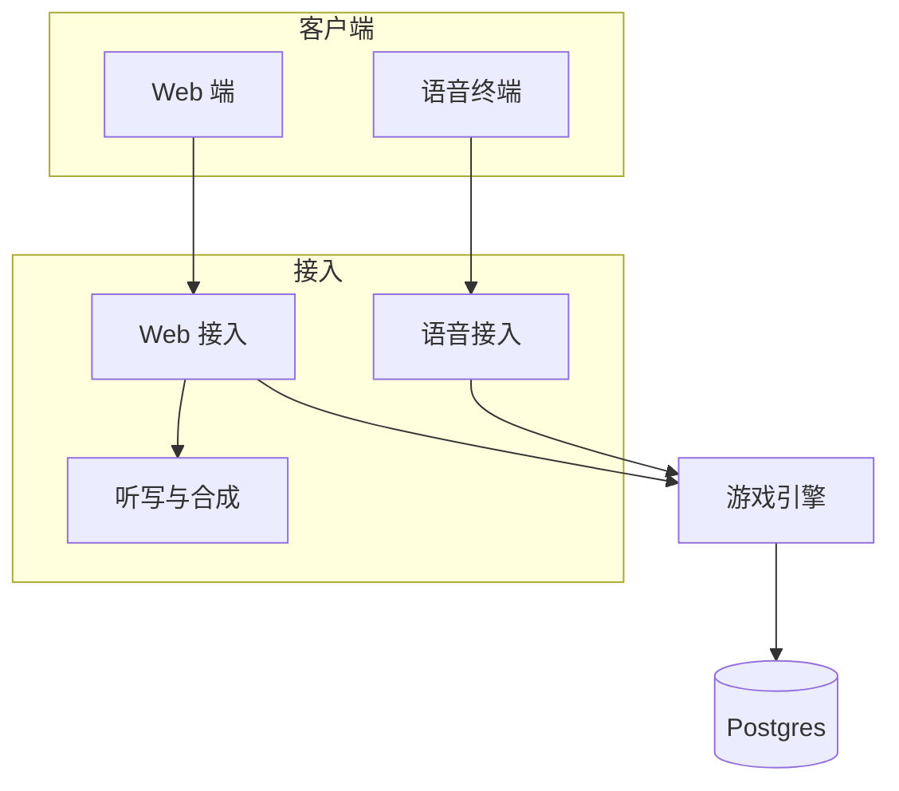

# 烈焰燎原 · 架构设计

本文规定系统结构、引擎边界、接入、存储、接口和模型边界。范围和商业以
[产品设计](./设计文档.md) 为准，胜负和数值以 [玩法设计](./gameplay-design.md)
为准，玩家听到的原句和时序以 [交互设计](./交互设计.md)
为准。本文不改写这三条。仓库里已有的界面和旧对局实现只作参考，模块边界以本文为准。

| 项     | 内容                                                                     |
| ------ | ------------------------------------------------------------------------ |
| 读者   | 对局服务、Web、灵矽接入、内容、测试                                      |
| 本文   | 系统结构、引擎、两种接入、存储、命令、HTTP/SSE/MCP、语音、时钟、模型约束 |
| 不包含 | 市场和收费、技能数值改写、主持原句改写、匹配队列、赛季、观战、2 对 2     |

---

## 1. 系统结构

对局服务从上到下是客户端、接入、游戏引擎。游戏引擎是唯一的规则与状态核心。Web
和语音都把外部协议翻译成同一条命令，读同一条投递。权威状态在
Postgres。进程内存不是权威。



请求向下进入游戏引擎。引擎写完投递后通知接入，接入沿客户端已经挂着的连接送回去。这条回路留在接入里，不另画成引擎下面的一层。

| 层       | 包含                                         | 职责                                           |
| -------- | -------------------------------------------- | ---------------------------------------------- |
| 客户端   | Web 端、语音终端                             | 采集、展示或照念。不结算                       |
| 接入     | Web 接入、语音接入、听写与合成               | 协议翻译。命令进引擎，投递按各自的传输送出     |
| 游戏引擎 | 命令处理、规则、时钟、主持、投递、角色、仓库 | 房间、施法、结算、胜负、主持句、倒数、一条投递 |
| 存储     | Postgres                                     | 权威快照、事件、幂等、到期时间                 |

游戏引擎里的时钟判断倒数何时结束、回执和断线何时到期。没有请求进来时，进程按库里的到期时间调用引擎写入。它不是引擎外面的另一块系统。

语音接入和 Web 接入并列，都在引擎之上。两边把同一套命令送进 `service`。Web 用
`/v1`。语音接入把这套命令封装成 MCP
工具，灵矽调用这些工具。已有地址的声音，只在结果交给需要播放函数的设备时才编。规则、主持、时钟和胜负不放在这里。引擎不导入任何一个接入。

Web 端展示快照和原句，并把 `/api/web/v1` 同源转发到 Web 接入。转发不结算。

### 1.1 引擎内部

系统结构图上游戏引擎保持一块。内部从上到下三层：编排、逻辑、数据和仓库。伤害、打断、房间和胜负都留在
`rules` 里。

```text
编排    service      命令处理。唯一写入口：身份、幂等、行锁。调用下面的逻辑，经仓库先写盘再通知
逻辑    rules        快照进，新快照和事件出。只读 characters
        clock        判断开窗、回执、断线、电脑截止是否到期。不写盘
        narration    事件按收听者写成 say。不改事件
        delivery     决定写给谁、游标何时前进。不发送
数据    characters   发布好的角色和技能。对局中只读
仓库    store        运行中的数据写入 Postgres：对局、事件、游标、房间、玩家和设备。不算规则
```

`characters` 和 `store` 同在最下层，包不合并。`characters`
是发布好的角色和技能，跟着版本走。`store` 是运行中产生的数据。逻辑读
`characters`。写盘只经过 `service` 进 `store`。

`rules`、`clock`、`narration`、`delivery`、`characters`
不读环境变量，不访问网络，不知道 HTTP 和 MCP。听写在 Web
接入里做完，引擎只收转写。语音终端自己转写，引擎同样只收转写。

一条命令进 `service` 之后：

```text
取行锁
  → 身份与幂等
  → 用 clock 看已经到期的开窗、回执和电脑截止
  → rules 给出新快照和事件
  → narration 按收听者写成 say
  → delivery 决定投递和游标
  → store 先写盘
  → 通知正在等的接入
```

SSE 在 120 秒内重连。语音侧重连不把挂着的工具调用交还给模型。是否到期由 `clock`
判断，写入由 `service` 完成。命令先到、而到期的事还没写时，这次请求先补写。

---

## 2. 模块

```text
src/engine/                      游戏引擎。不导入接入
  service/                       编排。命令处理，唯一写入口
  rules/                         逻辑。快照进，新快照和事件出
  clock/                         逻辑。判断到期，不写盘
  narration/                     逻辑。事件按收听者写成 say
  delivery/                      逻辑。写给谁、游标何时前进。不发送
  characters/                    数据。角色和技能，发布时校验
  store/                         仓库。运行中的数据
src/adapter/http/                Web 接入。/v1 与 SSE
src/adapter/mcp/                 语音接入。工具与订阅
  server.ts                      参数原样交给引擎。wait_event 只登记调用 id
  linx.ts                        把已有地址的 clips 编成 linx_stop / linx_play
src/speech/                      听写与合成。只被 Web 接入调用
supabase/functions/game/         唯一进程入口。挂上两个接入，并按时钟调用引擎
web/                             Web 端。不导入引擎，不放进 src
supabase/                        不放进 src。CLI 读取这里的函数和迁移
  migrations/                    新表只加迁移，不改已有迁移
```

`src` 只放对局服务的 TypeScript。`web/` 是 Next.js 工程，单独部署。`supabase/`
是 CLI 约定的位置：函数入口和迁移都从仓库根读取。函数文件只挂接 `src`
里的接入，不写规则。

进程只有 `supabase/functions/game` 一个。Web 走 `/v1`，语音走
`/mcp`，两条路径挂在同一个函数上。本地开发由 `src/main.ts` 起同一个进程。

测试放在对应包旁边，文件名 `*_test.ts`。角色和技能的配置文件放在
`src/engine/characters`。`supabase/functions/game`
只挂接两个接入和到期检查，不写规则。

搬迁前的快照是 tag `old-demo`。`src/game` 是咒语
demo，不属于这套目录。当前语音接入的实现还在调用它；接入改为调用引擎之后删掉。

`clock` 和 `delivery` 按本文补上，现有对局内核还没有改成调用它们。

| 类别 | 包            | 职责                                                    | 依赖                |
| ---- | ------------- | ------------------------------------------------------- | ------------------- |
| 编排 | `service`     | 命令处理。按 `battle_id` 串行，先写盘再通知             | 下面两层            |
| 逻辑 | `rules`       | 校验顺序、打断、结算、胜负、完成度公式                  | 只读 `characters`   |
| 逻辑 | `clock`       | 判断开窗、回执、断线、电脑施法是否到期                  | 只读时钟字段        |
| 逻辑 | `narration`   | 交互设计里的原句，换成「你 / 对手」或「甲 / 乙」        | 无 I/O              |
| 逻辑 | `delivery`    | 谁收到哪一条、游标何时前进。不发送                      | 无 I/O              |
| 数据 | `characters`  | 四名角色、同音和子串拒绝。对局中只读                    | 配置文件            |
| 仓库 | `store`       | 保存第 6 节各表。命令处理通过它加行锁                   | Postgres            |
| 接入 | `http`        | Web 的 HTTP 与 SSE                                      | `service`、`speech` |
| 接入 | `mcp`         | 把同一套命令封装成工具。订阅，并把投递原文送回          | `service`           |
| 接入 | `mcp/linx.ts` | 把已有地址的 `clips` 编成 `linx_play`                   | `mcp` 的投递        |
| 接入 | `speech`      | 音频换转写。首版不把置信度写成完成度。只被 Web 接入调用 | 七牛                |

Web 端不导入引擎。Web 接入和语音接入互不导入。

语音接入不读厂商的身份请求头。游戏服务器规定工具参数，模型调用时传入。浏览器不经过语音接入。

连接 `/mcp` 要带一把连接密钥，写在灵矽智能体的 MCP
配置里。它只证明调用来自登记过的语音终端，并给出终端种类和是否支持声纹，不代表哪一位玩家。没有密钥或密钥不对，返回
401。

| 参数               | 谁传     | 规则                                                               |
| ------------------ | -------- | ------------------------------------------------------------------ |
| `device_id`        | 每次调用 | 必填。第一次写入 `devices` 绑定玩家，之后必须是同一个              |
| `seat`             | 同机     | 必填，`A` 或 `B`。声纹在灵矽侧分完，模型把结果填进来。其他模式不填 |
| 转写、完成度、口令 | 按工具   | 与 Web 命令相同                                                    |

生命、护盾、伤害、技能 ID、胜负、版本和客户端时间戳即使写进参数也丢掉。

---

## 3. 技术路线

| 选择     | 决定                                         | 原因                                                                                                                                     |
| -------- | -------------------------------------------- | ---------------------------------------------------------------------------------------------------------------------------------------- |
| 裁判     | Deno，Supabase 边缘函数                      | MVP 不另管常驻机器。时钟在游戏引擎内。SSE 到时重连，调用 id 留在库里。Go 只在以后需要不被 150 秒掐断的进程时再考虑                       |
| 数据库   | Supabase Postgres                            | 快照、事件、幂等和到期时间要跨实例可见，并且先写盘再 `NOTIFY`。认证、存储和 Realtime 产品首版不用                                        |
| Web      | Next.js App Router                           | 展示快照和原句，并把 `/api/web/v1` 同源转发到 Web 接入。不进入引擎                                                                       |
| Web 转发 | Next 把 `/api/web/v1` 转到对局服务的 `/v1`   | 浏览器不跨域。Route Handler 只转发                                                                                                       |
| Web 命令 | HTTPS JSON                                   | `command_id` 可以安全重试                                                                                                                |
| 下一条   | 收听者自己挂着的订阅                         | Web 挂 `GET /v1/stream`。语音终端的 `wait_event` 只登记调用 id，结果从已打开的 `GET /mcp` 送回。服务器不向终端拨号                       |
| 语音对接 | 一条 `/mcp`。字段由游戏服务器规定，模型传入  | 工具名和投递字段所有语音终端相同。MCP 只校验连接密钥，不读厂商身份头。灵矽首版不查聊天记录，不播对方原声。电脑预备语音仍编成 `linx_play` |
| 主持     | 服务器模板                                   | 交互设计要求不改字                                                                                                                       |
| 听写     | 终端或对局服务代叫七牛。服务器不再识别第二遍 | 玩法规定结算看转写和完成度，不看录音                                                                                                     |
| 技能命中 | 标准技能名完全一致                           | 运行时不做拼音模糊、别名或快捷词                                                                                                         |
| 同音     | 发布前拒绝                                   | 完全匹配才站得住                                                                                                                         |
| 电脑     | 对局服务在截止时刻写入施法完成               | 字数 × 400 毫秒；灵矽再加 2 秒。慢终端不能把电脑推迟                                                                                     |
| 录音     | 只用于播放，默不留存                         | 取不到地址就不推迟战况                                                                                                                   |

Web 和边缘函数分开部署。函数可以多实例，都读写同一数据库，不要求粘性会话。

到期检查是函数里的一次请求：

```text
取 clock_lease 租约（持有者、过期时刻）。租约未过期就退出
  → 睡到最近的 next_due_at 与 120 秒二者中较早的时刻。收到 clock 通知就提前醒来重算
  → 调用游戏引擎写完所有到期的事，NOTIFY
  → 库里还有更晚的 next_due_at：续租，返回前再请求自己
  → 没有：释放租约，不占连接
```

租约时长长于一次检查最长的存活时间，见第 12 节。写下 `next_due_at`
的那条命令，在同一事务里发
`NOTIFY clock`，正在睡的检查提前醒来；发现租约已经过期，就请求一次到期检查。另有一个每分钟的定时任务做兜底，同样先取租约。每件到期的事在对局行锁里写，已经写过就跳过。检查断掉、下一次没发出去时，下一条命令或兜底任务补写。

玩家的命令不等检查。命令在行锁里先用 `clock` 看到期，`opens_at`
已过就当窗口已开，先补写开窗再处理这一句。

查询走连接池。`LISTEN` / `NOTIFY`
走能保持会话的直连。事务池化不把通知送到正听着的 SSE。每个函数实例只开一条
`LISTEN` 连接，按 `battle_id` 和 `device_id` 分给本实例里的各条
SSE。单实例挂着的 SSE 数有上限，见第 12 节。超过上限返回
503，客户端稍后重连，由平台分到别的实例。

`GET /mcp` 和 `GET /v1/stream` 在 120 秒内结束，客户端重连。服务器不因重连结束
`wait_event`，也不向模型返回结果。120 秒低于边缘函数大约 150 秒的限制。

免费项目大约一周没有足够的数据库访问会暂停。暂停期间连不上库，恢复后数据还在。

开发时 Web 端在 `3000`，对局服务在 `8787`。生产中 Web 把 `/api/web/v1`
转到边缘函数的 `/v1`，语音终端的地址都是该函数的 `/mcp`。转发不解释战报。

### 3.1 电脑的截止时刻

玩法里的「Web 在语音结束时提交、灵矽再等 2
秒提交」落成对局服务上的时刻。汉字数按 `cast_phrase` 的 Unicode 字素计数。

| 终端 | 最早写入电脑施法完成                                |
| ---- | --------------------------------------------------- |
| Web  | 倒数结束 + 汉字数 × 400 毫秒                        |
| 灵矽 | 倒数结束 + 汉字数 × 400 毫秒 + 开战时写入的附加等待 |

Web 开战时写入 0。灵矽开战时写入 2000 毫秒。引擎只读这个数。

玩家的合法完成先被处理，就取消这个计时并停掉预备语音。到点时回合已经离开
`WAITING_CAST`，不再结算。模型不替电脑调用 `submit_utterance`。

---

## 4. 一条命令怎么处理

练习、对电脑、联机和同机进入施法后共用
`rules`。Web、两台灵矽和同机都是同时念。同机在进规则之前多一道声纹座位：认不出说话人就不提交。打断只结束这一句，不锁下一回合。终端怎么把一句话变成这条命令，见第
5 节。

```text
开事务，按 battle_id 取得行锁，读快照和 version
  → 身份必须是这场对局的座位
  → 同一 command_id 且完成度同义（省略与 100 相同）：返回当时的结果
  → 同一 command_id 但完成度不同：COMMAND_ALREADY_PROCESSED，保留第一次
  → rules 校验
  → 写入新快照和事件，version 加 1，提交
  → 提交后事件对双方可读
```

同一对局的命令、到期写入和投降都在这把行锁里串行。两条施法完成不会都结算，阶段不会连跳。`version`
给客户端判断快照新旧。写入时再比一次读到的
`version`，作为防线：不一致说明有写入绕过了行锁，回滚并返回
`VERSION_CONFLICT`，不结算。

调用方这次结果写出之后，才推进他自己的游标。Web 写在 HTTP 响应里，语音写在 SSE
的工具结果里。对手的游标等他自己的订阅。进程内存只允许测试。正式房间以数据库那一行为准。

终端可以提交的只有：口令、转写、完成度、取消、战况回执，以及开始施法。Web
在按下麦克风时提交开始施法。同机由模型调用 `begin_cast`。请求里的
`hp`、`shield`、`damage`、`skill_id`、`winner`、`version`
和客户端时间戳一律丢弃。`device_id` 与同机的 `seat` 用工具参数里的值。

| 终端     | 引擎看见的身份                                                                      |
| -------- | ----------------------------------------------------------------------------------- |
| Web      | `Authorization: Bearer`，或由 Web 反代转发的 HttpOnly 会话。玩家 ID 来自服务端签名  |
| 语音     | 连接密钥通过后，看工具参数 `device_id`。第一次写入 `devices` 绑定玩家，之后必须相同 |
| 同机座位 | 工具参数 `seat`：`A` 或 `B`。缺了返回 `SEAT_UNKNOWN`                                |

设备号缺失则拒绝。同机认不出说话人时，不调用工具，本地说「没听清是谁，请再说一遍。」

---

## 5. 同一套命令，同一条投递

Web 接入和语音接入只做翻译。结算、打断、主持句和时钟都进 `service`，再进
`rules`。练习、对电脑、联机、同机用同一条命令，不各写一套接口。

`/v1` 是这套命令的浏览器传输。`/mcp`
把同一套命令封装成模型工具。语音接入在进程里把工具参数收成这条命令并调用
`service`，不先请求 `/v1`。

### 5.1 内部命令

```text
ActorCommand
  command_id
  battle_id          练习为空
  player_id          Web 来自会话。语音由 device_id 绑定。生命、伤害、技能 ID、胜负和版本丢弃
  seat               仅同机。A 或 B，来自工具参数 seat
  name               见下表
  round_no           施法才要。Web 带上；语音不带，服务器取收到时的当前回合
  text               转写或口令原文
  perfection         省略等于 100
  audio              NONE / UPLOADED_URL
```

| name        | Web                                                | 语音模型                                     | 服务器自己             |
| ----------- | -------------------------------------------------- | -------------------------------------------- | ---------------------- |
| `PRACTICE`  | `POST /v1/practice/evaluations`                    | 练习阶段的 `submit_utterance`                |                        |
| `BEGIN`     | `POST .../casts`，`kind=BEGIN`                     | `begin_cast`。同机开口时带 `seat`            | 回合打开时写入电脑座位 |
| `CANCEL`    | `casts`，`kind=CANCEL`                             | `cancel_cast`                                |                        |
| `COMPLETE`  | `POST .../utterances` 里不是口令的一句，或上传听写 | 对局里 `submit_utterance` 不是口令的一句     | 电脑到截止时刻         |
| `UTTERANCE` | `POST .../utterances` 里命中口令的一句             | 对局里 `submit_utterance` 命中口令的一句     |                        |
| `ACK`       | `POST .../acks`                                    | `ack_playback`                               |                        |
| 大厅口令    | 房间、选角、准备那几条路径                         | `submit_lobby_text`。同机选角和准备带 `seat` |                        |

一句话由服务器按阶段分：练习阶段做练习评估；对局里先对口令表，命中是
`UTTERANCE`，否则是 `COMPLETE`。Web 松手后的转写和语音的整句走同一条分法。

练习不创建对局，不写施法中。匹配和完成度公式与对战相同。

### 5.2 四种玩法

|                | 练习       | 对电脑                                                         | 联机                                   | 同机                                                                        |
| -------------- | ---------- | -------------------------------------------------------------- | -------------------------------------- | --------------------------------------------------------------------------- |
| 谁可以进       | Web 或灵矽 | Web 或灵矽                                                     | 同类终端各一台                         | 一台灵矽                                                                    |
| 会话           | 一条       | 人类一条。电脑没有会话                                         | 两条                                   | 一条设备，两个座位                                                          |
| 施法怎么进来   | 练习评估   | Web 先 `BEGIN`，松手送整句或 `CANCEL`。灵矽整句一次 `COMPLETE` | 与该终端的对电脑相同                   | 模型调用 `begin_cast`。整句出来再 `submit_utterance`。两句各有 `command_id` |
| 先到的合法完成 | 不改变对局 | 结算自己。对方已在施法中则打断对方                             | 同对电脑                               | 同对电脑                                                                    |
| 后到的完成     |            | 当时在施法中：`CAST_INTERRUPTED`。当时不在：`ROUND_CLOSED`     | 同对电脑                               | 同对电脑                                                                    |
| 下一回合       |            | 两边都能念                                                     | 两边都能念                             | 两边都能念。不换人                                                          |
| 回执           | 无         | 人类一份                                                       | 两侧各一份，或满 5 秒                  | 这只喇叭一份                                                                |
| 战况           | 练习句     | 你 / 对手                                                      | 各听自己的你 / 对手                    | 甲 / 乙，写一份                                                             |
| 对方原声       | 无         | 电脑预备语音                                                   | Web 命令里有地址就进 `clips`。灵矽不放 | 不从喇叭重放                                                                |
| 电脑多等       | 无         | 按第 3.1 节，看人类终端                                        | 无                                     | 无                                                                          |

联机遇到另一类终端，返回 `ROOM_TERMINAL_MISMATCH`。Web 没有同机入口。

### 5.3 开始施法和整句完成

Web 按下麦克风时发送 `BEGIN`，此时还没有技能名。松开后有转写就送到
`/utterances`，不是口令就是 `COMPLETE`；没有转写就
`CANCEL`。对方已经处于施法中，这一句可以打断对方。

灵矽模型只在整句出来后调用
`submit_utterance`。服务器在同一把锁里先做开始施法的校验：还没在施法中，并且校验通过，就把该座位标成施法中；然后立刻做施法完成。对方还没被标成施法中时，这一句只结算自己。对方稍后送到的完成返回
`ROUND_CLOSED`。

同机要标出「对方还在施法中」，由模型调用 `begin_cast`，带上 `device_id` 和
`seat`，不带转写，也不播放。乙也开口，再为座位乙调用一次。哪一句先形成合法
`COMPLETE`，哪一句结算；另一边若仍是施法中，就在同一次写入里改为已打断。做不到同时认，就只送先认出的那一句
`submit_utterance`，另一人这回合没有命令。

认不出说话人时，不调用 `begin_cast`，也不调用
`submit_utterance`，本地说「没听清是谁，请再说一遍。」

电脑的 `BEGIN` 由服务器在 `round.opened` 时写入。玩家的合法 `COMPLETE`
先到，就取消电脑截止时刻。到点时回合已离开等待，电脑不再结算。人声和电脑预备语音怎么放进投递，见第
5.6 节。

### 5.4 同一条投递

对局服务写给收听者的是一条投递。Web 和语音终端读的是同一份。

```text
Delivery
  event_id
  seq
  type
  say              已经按收件人视角渲染好
  clips            [{ kind, url }]
                   引擎已经有地址时才填：Web 上传的对方原声，或角色配置里的预备语音
  stop_clips       为真时，先停掉还没播完的上一段
  ack_required
  opens_at         仅倒数。服务器打开施法窗口的时刻
  opens_in_ms      仅倒数。写出这一帧时离开窗还有多少毫秒
  snapshot         Web 用来画血量。MCP 丢掉
```

规则和主持只填这些字段。引擎不查聊天记录，也不生成播放命令。Web 用 `opens_in_ms`
显示倒数，不拿本机时钟去比 `opens_at`。

`say` 为空、没有 `clips` 也不停播的事件，例如
`round.opened`，不送给语音订阅，只推进游标。模型不必为一条不出声的事件多走一轮工具调用。Web
照收，用来更新画面。

同机的出声对象是这台设备。甲和乙的战况合成一句，订阅一条。联机和电脑按人类座位各一条订阅。同机和灵矽联机都不放对方原声。

口令分类在适配之后、规则之前。对局中的一句先对口令表：看血、有什么技能、投降。命中就走
`UTTERANCE`，不进入施法。Web 的 `/utterances` 和语音的 `submit_utterance`
用同一张表。练习评估不经过口令表。

### 5.5 订阅

每个收听者同时只挂一个等待。服务器不向终端拨号。

模型调用 `wait_event` 后，`POST /mcp/message` 把这次 JSON-RPC id 写入
`subscriptions`，立即返回 `202`。这次 POST 不停留。灵矽已经打开的 `GET /mcp` 听
Postgres `NOTIFY`。投递写入后，SSE 发出 `event: message`，id
用挂着的那次调用。模型念 `say`。`linx_play` 和 `linx_stop` 由设备执行。Web 的
`GET /v1/stream` 听同一个 `NOTIFY`，帧里保留 `snapshot`。

开窗、回执超时和电脑截止由游戏引擎按库里的到期时间写入，不由每条 SSE
自己查时钟。

`GET /mcp` 在 120 秒内主动结束，灵矽重连。平台把断线当成这次工具失败时，模型再调
`wait_event`，库里没送出的投递改绑到新的 id
后送出。这是主路径。灵矽重连后若仍认原来的 id，新的 SSE 就用原来的 id
送出。这一点上线前实测，实测前按主路径实现。

一次订阅只送一条投递，按序号从旧到新。需要回执的战况先回执，服务器才写一条倒数投递。满
5 秒没有回执也写。倒数是一条投递，`say` 为「三。二。一。」，不要求回执，带
`opens_at`。`opens_at`
是写入时刻加倒数时长，到点服务器打开施法窗口。灵矽一次念完这句。Web 按
`opens_in_ms` 显示倒数，开口仍以服务器的窗口为准。

说话人这次命令已经带回的事件，推进他自己的游标，不再从订阅重放。对手的那一条等对手自己的订阅。写出之后才推进游标。连接在写出之前断了，投递还在。120
秒的 SSE 重连接上游标，不发「回来了。」玩家连接空档超过 10 秒才算离开；10
秒内回来才追加「回来了。」。窗口还没开就重发这条倒数，不把每一击再播一遍。

| 传输     | 谁  | 怎么挂               | 线上的样子                                                         |
| -------- | --- | -------------------- | ------------------------------------------------------------------ |
| `stream` | Web | `GET /v1/stream`     | SSE 的 `data` 就是投递，保留 `snapshot`。听 `NOTIFY`               |
| `parked` | MCP | `wait_event` 登记 id | `GET /mcp` 上的 `event: message`。`say` 给模型念。设备执行播放函数 |

`submit_utterance` 的结果写回这次调用的
id，里面是说话人自己该听的那句。对手进房、对手这一击、电脑预备语音和倒数，走已经挂着的
`wait_event`。平台取消旧调用后，新的 `wait_event` 换上新的
id，没送出的投递留给新的 id。

玩家开口时，`wait_event`
往往还挂着。灵矽要能在这时收音并调用对局工具；若平台为此取消挂着的调用，按上面换绑处理，投递不丢。这一点和重连一样，上线前实测。

语音终端共用这一条 MCP。工具名，以及结果里的
`say`、`clips`、`stop_clips`、`ack_required`、`wait` 都相同。`device_id`
和同机的 `seat` 由模型按游戏服务器的字段传入。MCP
只校验连接密钥，不读身份请求头。

`GET /mcp` 先收到 `endpoint`。`POST /mcp/message` 先回 `202`。有主持词时，结果从
SSE 的 `event: message` 以原来的 JSON-RPC id 回去。Web 继续走 `/v1`，不进 MCP。

下一台语音终端仍走这条 `/mcp`
和同一组工具。它若要播对方原声，就在施法完成里带上地址，引擎写入
`clips`。它若自己会播 `clips`，就不必再编函数。

### 5.6 咒语声音

录音不参与结算。喇叭上的顺序是：先处理 `stop_clips`，再按 `clips` 播放，然后念
`say`。不说「为您播放」，也不把血量放进音频标题。

| 声音                         | 什么时候写入 `clips`                                                    | 地址从哪来                 |
| ---------------------------- | ----------------------------------------------------------------------- | -------------------------- |
| 对手念完的原声               | 只在 Web。这句已经结算，并且施法完成里带了地址                          | 浏览器随命令交上的地址     |
| 电脑预备语音                 | `cpu.cast_began`。倒数一结束就放进 `clips`。语音时长是汉字数 × 400 毫秒 | 角色配置里该技能的预备文件 |
| 自己的录音                   | 不放                                                                    |                            |
| 灵矽上的对方原声             | 首版不放。听的那一侧没有对方的录音，服务器也不查聊天记录                |                            |
| 同机                         | 不放。两人听得见旁边的人。谁开口，设备先把喇叭停掉                      |                            |
| 口令、被拒绝、被打断的那一句 | 不放                                                                    |                            |
| 练习                         | 不放                                                                    |                            |

命令里没有地址，就不放对方原声，只送 `say`，不推迟倒数。

玩家的合法完成先于电脑截止时刻被处理时，给这个收听者的战况投递设
`stop_clips`。已经开口的预备语音停掉。电脑下一回合仍会再开始。

灵矽战况的工具结果只有要念的 `say`，不带 `linx_play`。电脑预备语音的 `clips`
仍由 `src/adapter/mcp/linx.ts` 编成 `linx_play`，参数只有
`audio_url`。`stop_clips` 为真时先放 `linx_stop`。模型只念
`content`。设备自己去拉地址。服务器不把录音字节放进结果，也不查聊天记录。

```json
{
  "jsonrpc": "2.0",
  "id": "对手正在挂着的 wait_event",
  "result": {
    "content": [
      { "type": "text", "text": "中了锐刃突刺。你920血。对手1000血。" }
    ]
  }
}
```

下一台语音终端若在施法完成里带上对方地址，引擎就写入 `clips`，沿用同一条投递。

### 5.7 幂等

两条终端共用 `commands`。对局里按 `battle_id + command_id`，大厅和练习按
`player_id + command_id`。同一个 `command_id`
再送来，返回第一次的结果。省略完成度与显式 100
视为同一次。换一个完成度重放，返回 `COMMAND_ALREADY_PROCESSED`。同机两句用两个
`command_id`。Web 的 `BEGIN` 和随后的那一句也是两个 `command_id`。

语音的 `command_id` 由语音接入拼出：`device_id`、MCP 会话号、JSON-RPC 请求
id。同一会话里重发同一个请求仍然幂等。SSE 重连换了会话，请求 id
重新计数也不会撞上旧命令。`begin_cast`、`cancel_cast` 和 `submit_utterance`
各用各的请求 id。

---

## 6. 存储

Supabase 项目只打开 Postgres。普通查询走池化。`LISTEN` / `NOTIFY`
走直连。服务角色密钥只在对局服务上。

| 表                 | 内容                                                          |
| ------------------ | ------------------------------------------------------------- |
| `sessions`         | 会话令牌哈希、`player_id`、可空的 `account_id`、终端种类      |
| `devices`          | 终端种类 + `device_id` 唯一；`player_id`、首次绑定时间        |
| `terminal_keys`    | 语音终端的连接密钥哈希、终端种类、是否支持声纹                |
| `accounts`         | 绑定关系。首版不存密码                                        |
| `entitlements`     | 已拥有角色。匿名会话逻辑上拥有首发四名角色                    |
| `practice_records` | 角色、转写、可空技能、完成度、时间。无胜负                    |
| `rooms`            | 四位房间号，在 `OPEN` 中唯一；终端种类；双方玩家；`battle_id` |
| `battles`          | 模式、状态、`version`、快照 JSON、时钟 JSON                   |
| `commands`         | 每条命令的第一次响应。见第 5.7 节                             |
| `battle_events`    | 只追加的事件，`say` 按收件人分开存。复盘和投递都读这里        |
| `deliveries`       | 已写出的最大序号。联机和电脑按人类座位各一条，同机按设备一条  |
| `subscriptions`    | MCP：每个设备当前挂着的一个 JSON-RPC id 和 MCP 会话号         |
| `clock_lease`      | 到期检查的租约：持有者、过期时刻                              |
| `battle_archives`  | 结束后的只读副本                                              |

Web 和语音都从自己的游标之后读 `battle_events`，不另存一份待发队列。

房间号开战、准备阶段离开或断线超过 10
秒后释放。已经开战的号码不能再加入。另一类终端加入返回
`ROOM_TERMINAL_MISMATCH`。

快照使用玩法设计第 6.3
节的对局、玩家和施法命令，并加上时钟字段：开窗时刻、等待回执的事件、回执截止、断线截止、电脑完成时刻、电脑技能。`battles.next_due_at`
取其中最早的一个，到期检查按它找对局。`effect_version`
在开战时抄进对局，之后不跟随配置改动。

事件先插入，写完即可读。`say` 写入时按收件人视角渲染好，联机存你 /
对手两份，同机存甲 / 乙一份。

| type                 | 发给谁         | 回执                 | 出声                             |
| -------------------- | -------------- | -------------------- | -------------------------------- |
| `room.updated`       | 房间内座位     | 否                   | 加入、选角、准备                 |
| `battle.started`     | 出声座位       | 是                   | 开战句                           |
| `countdown.started`  | 出声座位       | 否                   | `三。二。一。`，带 `opens_at`    |
| `round.opened`       | 各座位         | 否                   | 不出声。窗口已开                 |
| `cpu.cast_began`     | 人类座位       | 否                   | 预备语音。Web 同时显示技能名     |
| `utterance.rejected` | 说话人         | 否                   | 失败短句                         |
| `action.resolved`    | 出声座位       | 是，除非本击已经终局 | 战况。可含持续结算。不宣布轮到谁 |
| `battle.finished`    | 出声座位       | 否                   | 赢、输或平局                     |
| `battle.aborted`     | 出声座位       | 否                   | 「这局中断了。」                 |
| `presence.restored`  | 重连座位       | 否                   | 「回来了。……」                   |
| `review.line`        | 要求复盘的座位 | 否                   | 复盘                             |

同机一份回执。对电脑只等人类。两台终端等两侧，某一侧超过 5
秒没有回执就不再等。Web 命令里已有的原声放进 `action.resolved` 的
`clips`。灵矽不放对方原声。施法者自己、同机、口令和被拒绝的句子不填。

10 秒内回来不改游标去补播，只追加 `presence.restored`。120 秒的 SSE
重连不发这句。窗口还没开，就重发这条倒数，`opens_at` 不变。

---

## 7. API

对局服务基路径 `/v1`。Web 通过同源 `/api/web/v1` 转发到这里，路径去掉 `/api/web`
前缀。身体是 JSON。完成度省略表示 100。

玩家能听见的结果用 HTTP 200，正文里的 `code` 区分拒绝。传输和身份失败用
4xx，没有 `say`，终端不另编主持。

```json
{
  "code": "ASR_FAILED",
  "command_id": "6c0d0b2e-1b1a-4e2a-9c2d-0d9a0a0a0a0a",
  "battle_id": "2f6e0c4a-7b2d-4f0e-9a11-7c0e0d9a11aa",
  "version": 18,
  "event_id": "0d1c2b3a-4e5f-6071-8293-a4b5c6d7e8f9",
  "say": "咒语没成。",
  "clips": [],
  "stop_clips": false,
  "ack_required": false,
  "snapshot": {}
}
```

`say` 为空则不出声。Web 用 `snapshot` 画血量，同时显示 `say`，并播放
`clips`。MCP 丢掉 `snapshot`，把 `say` 交给模型念。

### 7.1 拒绝码

玩法设计里的码原样使用。出声句子以交互设计为准。

| code                         | 含义                             | say                                            |
| ---------------------------- | -------------------------------- | ---------------------------------------------- |
| `ACCEPTED`                   | 已写入                           | 由事件渲染                                     |
| `ASR_FAILED`                 | 对不上标准技能名                 | 咒语没成。                                     |
| `AMBIGUOUS_SKILL`            | 一句里含该角色两个及以上技能名   | 一次一道。                                     |
| `SKILL_EXHAUSTED`            | 每局一次已经用过                 | 这招已经用过。                                 |
| `BASIC_CONSECUTIVE_REJECTED` | 基础技能上一回合刚用过           | 这招不能连着念。                               |
| `REUSE_LIMIT_REJECTED`       | 次数或间隔不够                   | 这招还不能再用。                               |
| `INVALID_PERFECTION`         | 完成度不是 0–100 的有限数值      | 不出声。清除自己的施法中                       |
| `ROUND_NOT_OPEN`             | 还在倒数                         | 不出声                                         |
| `ROUND_CLOSED`               | 回合已离开等待，且当时不在施法中 | 不出声                                         |
| `CAST_INTERRUPTED`           | 当时在施法中，对方先写入         | 不出声。打断句已在战况里播过。下一回合仍可施法 |
| `ACTION_DISABLED`            | 石化、麻痹或冻结                 | 这回合你不能行动。                             |
| `ACTOR_DEAD`                 | 行动者已死亡                     | 不出声                                         |
| `COMMAND_ALREADY_PROCESSED`  | 同一命令换了完成度               | 不出声，保留第一次结果                         |
| `VERSION_CONFLICT`           | 写入时版本不符，已回滚           | 不出声，重新读取                               |
| `CHARACTER_REQUIRED`         | 未选角就准备                     | 先说角色名。                                   |
| `CHARACTER_NOT_OWNED`        | 未拥有                           | 还没有这个角色。并再说一遍四名首发角色         |
| `ROOM_NOT_FOUND`             | 没有这个号码，或已经开战         | 没有这个房间。                                 |
| `ROOM_TERMINAL_MISMATCH`     | 另一类终端的房间                 | 这个房间进不去。                               |
| `PHASE_REJECTED`             | 这个阶段不允许该调用             | 不出声                                         |
| `SEAT_UNKNOWN`               | 同机没有可信座位                 | 不出声                                         |

技能名在玩法设计第 4.3 节第 8 步内按这个顺序：先看是否作为子串包含两个及以上
`cast_phrase`，是则 `AMBIGUOUS_SKILL`；再看是否与其中一个完全相同；否则
`ASR_FAILED`。同一角色的技能名不得互为子串，发布时拒绝。

对局中的一句，Web 送到 `/utterances`，语音是 `submit_utterance`：

```json
{
  "command_id": "6c0d0b2e-1b1a-4e2a-9c2d-0d9a0a0a0a0a",
  "round_no": 3,
  "transcribed_text": "破风斩",
  "perfection": 100,
  "audio_url": "https://example.invalid/utterance"
}
```

服务器先对口令表，不是口令就按 `COMPLETE`
处理：没在施法中时，合法完成视为开始并立即完成。`casts` 的 `kind` 只允许 `BEGIN`
和 `CANCEL`。`BEGIN` 不看转写。`CANCEL` 只清自己的施法中。

`perfection` 字段保留。玩法公式不变。首版终端省略它，服务器按 100
进入公式。识别置信度、发声和节奏都不写入这个字段。客户端若仍送来 0–100
的有限数值，按玩法校验并结算。

快照副本只含该调用方需要的双方生命、护盾、`can_cast`、角色和回合状态。`can_cast`
只用于按钮，提交时重新计算。快照不包含命令幂等记录。可用技能由服务器计算。Web
上的生命、护盾和技能次数以这份快照为准。

### 7.2 Web 与练习

| 方法   | 路径                         | 行为                                                                            |
| ------ | ---------------------------- | ------------------------------------------------------------------------------- |
| `POST` | `/v1/sessions`               | 匿名会话                                                                        |
| `POST` | `/v1/accounts/bind`          | 用 10 分钟、一次有效的绑定码接通账号                                            |
| `GET`  | `/v1/characters`             | 可选角色                                                                        |
| `GET`  | `/v1/characters/:id`         | 7 个技能的展示。未拥有则拒绝                                                    |
| `POST` | `/v1/practice/evaluations`   | 与对战同一匹配和公式。不创建对局                                                |
| `GET`  | `/v1/me/practice`            | 练习记录                                                                        |
| `GET`  | `/v1/me/battles/:id`         | 只读归档                                                                        |
| `POST` | `/v1/battles`                | `{ "mode": "VS_CPU", "opponent_character_id" }`。省略对手则烈焰剑士。电脑已准备 |
| `POST` | `/v1/rooms`                  | 联机开房，返回四位号码                                                          |
| `POST` | `/v1/rooms/join`             | `{ "code" }`。终端种类必须相同                                                  |
| `POST` | `/v1/battles/:id/character`  | 开战前选角                                                                      |
| `POST` | `/v1/battles/:id/ready`      | 未选角拒绝。双方齐了才开战                                                      |
| `POST` | `/v1/battles/:id/casts`      | 开始施法或取消                                                                  |
| `POST` | `/v1/battles/:id/utterances` | 一句转写。看血、技能列表、投降，否则按施法完成                                  |
| `POST` | `/v1/battles/:id/audio`      | 上传 WAV。服务听写后与 `/utterances` 同一条分法。见第 8 节                      |
| `POST` | `/v1/battles/:id/acks`       | `{ "event_id" }`                                                                |
| `GET`  | `/v1/battles/:id`            | 快照副本。重连补一次，不代替 SSE                                                |
| `GET`  | `/v1/stream`                 | 本玩家的 SSE                                                                    |
| `POST` | `/v1/battles/:id/rematch`    | 两侧都同意且没换角才新建对局并开战                                              |
| `POST` | `/v1/battles/:id/review`     | `{ "from_start": false }` 最后三击                                              |
| `POST` | `/v1/battles/:id/leave`      | 准备完成前离开则房间不进入战斗                                                  |

没有匹配队列接口。Web 没有同机双人。`LOCAL_DUO`
只接受声明了声纹的语音终端，当前是灵矽。

终局之后的施法和投降返回已持久化的终局，不改写胜负。投降与结算共用行锁：锁内若这一击已经分出胜负，沿用该结果。

SSE 帧：

```text
event: message
data: {"event_id":"...","seq":42,"type":"countdown.started","say":"三。二。一。","clips":[],"stop_clips":false,"ack_required":false,"opens_at":"2026-10-25T03:00:03.000Z","opens_in_ms":2980,"snapshot":{}}
```

浏览器用 `event_id` 去重。血量以最新 `snapshot` 为准。

### 7.3 语音 MCP

所有语音终端走这一条。它封装的是第 5 节的命令，灵矽是调用方。`GET /mcp` 打开
SSE，`POST /mcp/message` 接收
JSON-RPC。工具参数就是游戏服务器规定的字段。引擎给出的投递：

```json
{
  "code": "ACCEPTED",
  "phase": "BATTLE",
  "say": "锐刃突刺命中。你1000血。对手920血。",
  "clips": [],
  "stop_clips": false,
  "event_id": "0d1c2b3a-4e5f-6071-8293-a4b5c6d7e8f9",
  "ack_required": true,
  "wait": true
}
```

电脑预备语音才由 `src/adapter/mcp/linx.ts` 把已有地址的 `clips` 编成
`linx_play`。对方原声不编。灵矽战况只把 `say` 放进 `content`。`ack_required`
为真则播完调用 `ack_playback`。`wait` 为真则调用 `wait_event`，服务器只登记
id。主持词从已打开的 SSE
送回。平台取消这次调用后再调，库里没送达的投递改绑到新的 id。`command_id`
的拼法见第 5.7 节。

每次调用都带 `device_id`。同机再带 `seat`。工具参数里没有生命、伤害、技能 ID
和胜负。多出来的这类字段丢弃。

| 工具                | 阶段             | 作用                                                                                           |
| ------------------- | ---------------- | ---------------------------------------------------------------------------------------------- |
| `submit_lobby_text` | 大厅、练习、复盘 | 转写原样送入。服务器匹配大厅口令：选角、练习、对电脑、两个人、开房、加入、准备、再来一局、复盘 |
| `submit_utterance`  | 练习、对局       | 整句。练习阶段先对「结束练习」，否则做练习评估；对局里先对口令表，否则按施法完成               |
| `begin_cast`        | 对局             | 开口。同机带 `seat`                                                                            |
| `cancel_cast`       | 对局             | 放弃这一句                                                                                     |
| `ack_playback`      | 需要时           | 战况播完的回执                                                                                 |
| `wait_event`        | 需要时           | 登记等待，下一条从 SSE 送回                                                                    |

模型只看见这 6
个工具。房间号、角色名和「两个人」都在原话里，由服务器解析。「两个人」只在连接密钥声明了声纹的终端上生效，其他终端重读当前提示。阶段不对的调用返回
`PHASE_REJECTED`，`say` 为空。

大厅口令与交互设计一致：角色显示名、对电脑、两个人、开始练习、练技能、结束练习、开房间、再说一次、四位数字、准备、再来一局、复盘、从头复盘。匹配失败时重读当前提示，不新编玩法。房间号用顿号分开来念。

一句只提交一次。声纹登记的句子仍由服务器发出：「先由甲说话。」「甲已就座。换乙说话。」「乙已就座。甲先说角色名。」开战不宣布轮到谁。模型把声纹分出的
`A` 或 `B` 填进 `seat`。就座时甲、乙各说的那一句，模型用 `submit_lobby_text`
带上 `seat` 送来，服务器据此确认座位并发出下一句。

引擎有地址就放进 `clips`。灵矽首版没有对方原声。见第 5.6 节。

---

## 8. 语音

两种 Web 输入都保留。听写在 Web
接入里完成，引擎只收转写。首版都不从识别结果制造完成度。

| 模式       | 浏览器做什么                                | 服务器留下什么                                   |
| ---------- | ------------------------------------------- | ------------------------------------------------ |
| 按住后上传 | AudioWorklet 采集 16 kHz、单声道、PCM16 WAV | 七牛听写得到转写。完成度省略，按 100             |
| 浏览器识别 | Web Speech API                              | 采用浏览器转写。置信度不换算成完成度。省略按 100 |

上传模式里，客户端不能改写听写结果再送去结算。浏览器识别模式里，转写由终端上报，服务器校验技能名。不把编辑距离或置信度写成完成度。发声和节奏的比较留在以后，写入同一个
`perfection` 字段。

录音限制：只收约定的 WAV，限制采样率、大小和单段时长。听写失败不修改对局。同一
`command_id` 已经听写过就复用结果，不重复计费。默不保存原始录音。

开口时：

```text
按下 → POST casts，kind=BEGIN
松开且有识别结果 → POST utterances，或上传音频后由服务听写，再按同一条分法
松开且没有结果 → POST casts，kind=CANCEL
```

Web
上的语音状态只描述本机：等待权限、录音、上传、已提交、被拒绝。它不推测伤害。只有快照允许开口、本机没有未完成请求时才能再按下。

练习念对时句式是「完成度{n}。{技能名}。{效果}。」省略时 n 为
100。没念对时用「咒语没成。」或「一次一道。」

Web 的语音合成只朗读服务器已经生成的
`say`。浏览器不能提交任意文本。合成失败不影响结算，页面继续显示文字。

---

## 9. 回合和时钟

阶段顺序：`COUNTDOWN` → `WAITING_CAST` → `SETTLING` → `ENDING`。终局停在
`FINISHED`。Web 不调用推进接口。

```text
双方准备齐
  → battle.started
  → 需要出声的一侧回执，或满 5 秒
  → countdown.started：一句「三。二。一。」，opens_at 为写入时刻加倒数时长。不要求回执
  → 到 opens_at，写入 WAITING_CAST，发出 round.opened
  → 对电脑同时发出 cpu.cast_began，把电脑标为施法中，并武装截止时刻
等待施法
  → Web 按下麦克风的 BEGIN，或模型的 begin_cast，把该座位标为施法中
  → 先写入的合法 COMPLETE 进入结算，并在同一次写入里打断对方仍在施法中的那一句
结算
  → 这一击已经分出胜负：battle.finished，不做回合结束效果，不再倒数
  → 否则做完回合结束五步，合成一条 action.resolved
  → 回执之后若双方仍存活，进入下一轮倒数
```

窗口在服务器时钟上打开，不等终端把这句念完。早到的开始和完成返回
`ROUND_NOT_OPEN`。倒数时长按灵矽念完「三。二。一。」再加一轮工具调用来定，见第
12 节，上线前按实测调整。

同机也同时念。设备能同时认出两个人，就把两句都送上：先被处理的合法完成结算，并打断另一边已经处于施法中的那一句。只认出一句时，另一句不存在，这一回合就只有这一句。没念成合法技能只拒绝这一句，另一人还在念就继续。被行动限制的座位本回合不能念，另一个座位照常可以。不换人，开战也不宣布轮到谁。

看血不报回合号。生命不同时，Web
和两台灵矽先说「你领先。」或「你落后。」，同机说「甲领先。」或「乙领先。」生命相同则直接报血量。最后是「可以念了。」或「这回合你不能行动。」

被打断的人只在对方那条战况里听到一次「吟唱被打断。」下一回合两边都可以念。他后到的完成
`say` 为空。技能造成的行动限制仍说「这回合你不能行动。」，这句话不跟着打断出现。

不可恢复的结算失败写 `battle.aborted`，说「这局中断了。」，不伪造胜负。

再开一局：两侧都同意后新建
`battle_id`，生命、护盾、次数和状态重置，角色沿用。任一侧先换了角色，则停在准备，重新准备。上一局归档保留。

---

## 10. 模型约束

灵矽上的模型负责大厅路由和照念。Web
不经过这个模型。电脑选技能是规则：基础技能可用就用基础技能，否则用名称最短的可释放角色技能，长度相同按配置顺序取第一张。

| 项   | 约束                                                       |
| ---- | ---------------------------------------------------------- |
| 温度 | 0                                                          |
| 工具 | 只打开第 7.3 节。关闭记忆、开场白、搜索和其他内置工具      |
| 空闲 | 平台空闲超时不少于 300 秒                                  |
| 拾音 | 一句一转写。模型不合并两句，也不把一句拆成两次提交         |
| 提示 | 只重复「照念 `say`」和禁止项。血量和技能名单以工具结果为准 |

| phase      | 允许                                                                          |
| ---------- | ----------------------------------------------------------------------------- |
| `LOBBY`    | `submit_lobby_text`、`ack_playback`、`wait_event`                             |
| `PRACTICE` | `submit_utterance`、`submit_lobby_text`、`ack_playback`、`wait_event`         |
| `BATTLE`   | `submit_utterance`、`begin_cast`、`cancel_cast`、`ack_playback`、`wait_event` |
| `REVIEW`   | `submit_lobby_text`、`ack_playback`、`wait_event`                             |

服务器仍拒绝阶段不对的调用。模型必须：

1. `say` 逐字播出。不补回合号，不加「为您播放」。
2. 只念 `content` 里的原文。空文本就沉默。播放交给设备执行的 `funcs`。
3. 需要回执就先 `ack_playback`，再按 `wait` 调用 `wait_event`。这句调用等 SSE
   上的结果。平台取消或失败时立刻再调，未送达的句子仍在。
4. 不自己倒数。
5. 对局转写原样提交。不改成相近技能名。完成度省略。不把识别置信度填进完成度。
6. 大厅和复盘的话都交给 `submit_lobby_text`，不自己解析房间号和角色名。
7. 不替电脑或对手提交。同机认不出说话人时不调用工具。

模型不判断技能名、打断、伤害、治疗、护盾、状态和胜负，不生成房间号，也不在服务器确认前宣布对手已经加入或准备。

---

## 11. 角色和技能

技能配置按 `effect_version` 取用。发布前必须通过：每个角色恰好 1 个基础技能和 6
个角色技能；`name` 与 `cast_phrase`
相同且唯一；没有别名和快捷词；技能名互不为子串；去掉声调后的拼音序列不得相同；不得等于大厅或战场口令，也不得等于仓库里的闲聊词表。`LIMITED_REPEAT`
必须写明次数和间隔。效果顺序就是结算顺序。数值以玩法设计第 3.6–3.10
节为准。`phrase_length_tier` 不参与谁先结算。

首发四名角色对匿名会话和账号都视为已拥有。之后的角色要有权益行才能选、才能练。购买接口不在首版。

绑定后，已购角色、练习记录和只读档案跟着账号走。进行中的对局仍属于原来的
`player_id`。

---

## 12. 参数

这些数不是玩法回合时长。单回合、单局都不因时间到而判平。

| 参数             | 值                     | 归属                                         |
| ---------------- | ---------------------- | -------------------------------------------- |
| 倒数时长         | 3000 毫秒              | 本文。从倒数写入到开窗，上线前按灵矽实测调整 |
| 战况回执等待     | 5000 毫秒              | 玩法与交互                                   |
| 断线保留         | 10000 毫秒             | 玩法与交互                                   |
| 电脑每字         | 400 毫秒               | 玩法                                         |
| 灵矽电脑附加等待 | 2000 毫秒              | 玩法                                         |
| 绑定码           | 10 分钟，一次          | 本文                                         |
| SSE 重连         | 120 秒                 | 本文。低于边缘函数约 150 秒的限制            |
| 单实例 SSE 上限  | 200 条                 | 本文。超过返回 503，按直连配额调整           |
| 到期兜底         | 每分钟一次             | 本文。只补写漏掉的到期，不代替到期检查       |
| 到期检查租约     | 150 秒，每轮续租       | 本文。不短于一次检查最长的存活时间           |
| 房间号           | 四位，开战或放弃后释放 | 位数来自产品，释放规则在本文                 |

---

## 13. 验收

伪造的伤害、治疗、护盾、次数、胜负和版本号不能改变快照。两条施法完成并发时只有一个
`ACCEPTED`，另一个是 `CAST_INTERRUPTED` 或
`ROUND_CLOSED`。同机两句和两台终端走同一把锁。Web 的 `/utterances` 与灵矽的
`submit_utterance` 用同一条分法，进入同一套
`rules`。下一条来自该收听者自己的订阅，不来自服务器拨号。对方原声只在 Web
的命令里已有地址时进入 `clips`。灵矽首版不播放对方原声。

| 来源             | 落点                                                                                                                                                                                                  |
| ---------------- | ----------------------------------------------------------------------------------------------------------------------------------------------------------------------------------------------------- |
| 玩法设计第 8 节  | `src/engine/rules` 的纯测试                                                                                                                                                                           |
| 交互设计第 6 节  | `src/engine/narration` 用固定事件断言原句、视角，以及战斗播报不出现回合号                                                                                                                             |
| 产品设计第 10 节 | Web 与 MCP 走同一套命令和 `rules`：学习、对电脑、同机座位、四位房间号、异种终端拒绝、绑定后的练习记录                                                                                                 |
| 时钟             | 可控时钟断言 5 秒不等回执、`opens_at` 开窗、10 秒离开、电脑截止。租约同时只有一个持有者。新的更早到期能叫醒正在睡的检查。检查断掉后由下一次命令或兜底补写。平台取消 `wait_event` 后，新调用拿到主持词 |
| 投递             | 不出声的事件不送语音订阅。Web 的倒数按 `opens_in_ms` 显示                                                                                                                                             |
| 语音接入         | SSE 重连后请求 id 从 1 重来，不命中旧命令。没有连接密钥返回 401。不同 `device_id` 不能操作别人的座位                                                                                                  |
| 进程边界         | Web 端不调用 `rules`。引擎不导入接入。权威快照只在 Postgres                                                                                                                                           |

首版不做匹配队列、Web 同机、Web 与灵矽混房、2 对
2、赛季和观战。新的语音终端走同一条 `/mcp`
和同一个游戏引擎。对方原声要播，就在施法完成里带地址。灵矽首版不查聊天记录，不播对方原声。电脑预备语音仍由
`src/adapter/mcp/linx.ts` 编成 `linx_play`。
