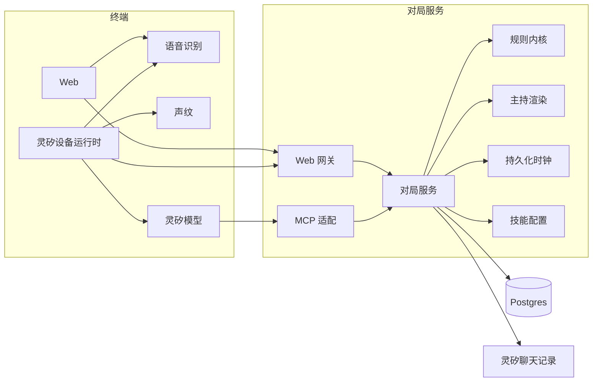

# 烈焰燎原 · 架构设计

本文规定首版怎么部署、怎么存、接口长什么样，以及模型可以做什么。范围和商业以
[产品设计](./设计文档.md) 为准，胜负和数值以 [玩法设计](./gameplay-design.md)
为准，玩家听到的原句和一场时序以 [交互设计](./交互设计.md)
为准。本文不改写这三条。

| 项     | 内容                                                                                     |
| ------ | ---------------------------------------------------------------------------------------- |
| 读者   | 服务端、Web、灵矽接入、内容、测试                                                        |
| 本文   | 逻辑架构、技术路线、存储、HTTP/WebSocket/MCP、时钟、模型约束                             |
| 不包含 | 市场和收费、技能数值、主持原句的改写、赛季、观战、匹配队列、2 对 2                       |
| 旧代码 | `src/game`、`src/battle`、`src/mcp` 是上一套对局，不实现本文，本文也不吸收那套阶段和数值 |

首版要能独立跑完的路径：Web 学习、Web 对电脑、Web 对 Web
联机、一台灵矽的学习和对电脑、一台灵矽的同机双人、两台灵矽联机、绑定后的进度互通、复盘和再开一局。

---

## 1. 架构

游戏只有一份权威：对局服务。Web
和灵矽都是终端。语音识别在终端。主持句子由服务器按已落库事件渲染。大模型只在灵矽上把大厅口令对应成工具调用，并把服务器给的句子念出来。



### 1.1 组件

| 组件       | 职责                                                                 | 明确不做                       |
| ---------- | -------------------------------------------------------------------- | ------------------------------ |
| 规则内核   | 纯函数。校验、打断、结算、胜负、完成度公式                           | 网络、文案、时钟、数据库       |
| 对局服务   | 按 `battle_id` 串行执行命令，先写盘再通知                            | 信任终端上传的生命、伤害和胜负 |
| 主持渲染   | 把事件渲染成交互设计里的原句，并按视角换成「你 / 对手」或「甲 / 乙」 | 改字、补充结算里没有的效果     |
| 持久化时钟 | 倒数拍子、战况回执截止、断线 10 秒、电脑施法截止                     | 玩法回合超时、客户端本地倒数   |
| 技能配置   | 按 `character_id`、`skill_id`、`effect_version` 提供不可变配置       | 接受客户端上传的数值           |
| Web 网关   | 匿名会话、命令 HTTP、事件 WebSocket、设备运行时的声纹座位绑定        | 在浏览器里结算                 |
| MCP 适配   | 把灵矽工具调用转成同一套命令，挂起 `wait_event`                      | 让模型申报设备号、座位或伤害   |
| 终端识别   | 产出整句转写和 0–100 完成度                                          | 服务器不重做转写，不重算完成度 |
| 灵矽模型   | 大厅工具选择；照念 `say`；按 `linx_play` 播放                        | 技能匹配、打断、数值、自己倒数 |

规则内核对外只有一个入口：给定快照、配置和一条命令，返回新快照、追加事件和拒绝码。调用方拿到的快照是副本。

新代码放在 `src/match/`，按
`rules`、`narration`、`content`、`store`、`clock`、`service`、`web`、`mcp`
拆开。不要把本文实现进 `src/game`、`src/battle` 或 `src/mcp`。

### 1.2 信任边界

终端可以提交的只有：身份已经建立之后的口令、转写文字、完成度、取消、战况回执、练习评估，以及
Web 开口时的「开始施法」。

下列字段出现在请求体里也要丢弃，不得写入快照：`hp`、`shield`、`damage`、`skill_id`（由转写匹配得出）、`winner`、`version`、客户端时间戳、模型自报的
`device_id` 和座位。

身份来源：

| 终端     | 身份                                                                     |
| -------- | ------------------------------------------------------------------------ |
| Web      | `Authorization: Bearer <session_token>`。建会话时发给浏览器              |
| 灵矽     | 请求头 `X-Linx-Device-Id`、`X-Linx-Agent-Id`、`X-Linx-Session-Id`        |
| 同机座位 | 设备运行时在声纹比对成功后写 `X-Linx-Seat: A` 或 `B`。模型参数里没有座位 |

`X-Linx-Device-Id`
缺失则拒绝，不建座位。同机认不出说话人时，设备运行时不调用模型工具，本地说「没听清是谁，请再说一遍。」

### 1.3 一条命令怎么走

Web
Web、两台灵矽和同机双人都是同时施法，共用同一个规则内核。同机在送命令之前用声纹标出这句话是谁的。认不出人就不提交。能同时认出两个人，就把两句都送上。做不到时，先被识别出来的那一句参加抢先。

```text
读取 battle_id 的快照和 version
  → 身份必须是这场对局的座位
  → 同一 command_id 且完成度同义（省略与 100 相同）：返回当时的结果，不重复结算
  → 同一 command_id 但完成度不同：返回 COMMAND_ALREADY_PROCESSED，保留第一次结果
  → 规则内核校验
  → 仅当 version 仍等于读到的值时写入新快照、事件和 version+1
  → 施法完成发生版本冲突：按最新快照重新校验，不得结算第二个技能
  → 推进阶段发生版本冲突：返回 VERSION_CONFLICT，不得连跳两个阶段
  → 写盘成功之后事件对双方可读。调用方的同步响应推进调用方游标；对手的游标等他自己的流来推进
```

单个对局的请求在数据库行锁内串行。多实例可以同时接请求，竞争的是同一行。进程内存只允许测试和单机开发使用，不能当正式房间的权威。

---

## 2. 技术路线

| 选择         | 决定                           | 原因                                                                                                                                          |
| ------------ | ------------------------------ | --------------------------------------------------------------------------------------------------------------------------------------------- |
| 运行时       | 常驻 Deno 进程                 | 倒数、回执截止和断线宽限都是服务器时钟，需要进程拉起后能从 Postgres 把到期时刻补上                                                            |
| 权威存储     | Postgres                       | 快照、事件、命令幂等和时钟都要跨实例可见，并且先写盘再广播                                                                                    |
| Web 命令     | HTTPS JSON                     | 用 `command_id` 重试，不把结算绑在一条长连接上                                                                                                |
| Web 事件     | WebSocket `GET /v1/stream`     | 开战、拍子、战况和胜负推给浏览器。断线后 10 秒内重连，不补播每一击                                                                            |
| 灵矽         | MCP SSE                        | 平台的接入方式是工具调用。`GET /mcp` 建立 SSE，`POST /mcp/message` 提交 JSON-RPC。`wait_event` 挂起；连接被切断后再次调用，未送达事件还在库里 |
| 主持         | 服务器模板                     | 交互设计要求不改字。模型不是文案生成器                                                                                                        |
| 识别         | 终端                           | 玩法已规定服务器只收转写和完成度                                                                                                              |
| 技能是否命中 | 标准技能名完全一致             | 运行时不做拼音模糊、别名或快捷词                                                                                                              |
| 同音拒绝     | 发布前                         | 运行时的完全匹配才站得住                                                                                                                      |
| 电脑         | 服务器计时器替电脑写入施法完成 | 截止时刻仍是玩法里的字数 × 400 毫秒；灵矽再加 2 秒。慢终端不能把这个时刻推迟                                                                  |
| 录音         | 只播放                         | 灵矽用会话聊天记录里的 `audioUrl` 换 1 小时签名地址。Web 自己上传可播放地址。取不到就不推迟战况                                               |

边缘函数可以托管别的短请求，不承担对局时钟。Postgres
可以用托管实例。对象存储不是首版结算的依赖：电脑咒语语音和短音效由游戏服务器提供静态资源，对方原声使用终端或灵矽已经给出的地址。

部署上，Web
静态资源和游戏服务器分开。游戏服务器至少两实例时，仍然读写同一数据库。不要求粘性会话。某个实例在倒数过程中退出，其他实例的时钟循环看到到期的
`next_beat_at` 后继续发拍。

### 2.1 和玩法时钟的对应

玩法写的是「Web 在语音结束时提交电脑的施法完成，灵矽在语音结束后再等 2
秒提交」。实现上，这两个时刻由对局服务写入：

| 终端 | 电脑施法完成的最早时刻                       |
| ---- | -------------------------------------------- |
| Web  | 倒数结束时刻 + 汉字数 × 400 毫秒             |
| 灵矽 | 倒数结束时刻 + 汉字数 × 400 毫秒 + 2000 毫秒 |

汉字数按该技能 `cast_phrase` 的 Unicode
字素计数。玩家的合法施法完成若先被处理，取消这个计时器，并停掉已经发出的播放。到点时若回合已离开
`WAITING_CAST`，不再结算。

终端可以发 `cpu_complete`
当作「播放已结束」的提示。早于上表时刻的提示直接忽略，不占用
`command_id`。到点后的重复提示返回已经写好的结果。模型不替电脑调用
`submit_utterance`。

### 2.2 目录

```text
src/match/rules/        快照进出、校验顺序、结算、胜负
src/match/narration/    事件 + 视角 → say
src/match/content/      四名角色配置、发布校验
src/match/store/        仓库接口、Postgres、内存实现
src/match/clock/        拍子、回执、断线、电脑截止
src/match/service/      串行入口
src/match/web/          /v1 HTTP 和 WebSocket
src/match/mcp/          /mcp 工具
```

`src/match/rules` 和 `src/match/narration` 不读环境变量，不访问网络。

---

## 3. 存储

一场对局一份快照，外加只追加的事件和命令。练习不写对局表。

### 3.1 表

| 表                 | 键                          | 内容                                                                           |
| ------------------ | --------------------------- | ------------------------------------------------------------------------------ |
| `sessions`         | `session_token` 哈希        | `player_id`、`account_id` 可空、终端种类、创建时间                             |
| `accounts`         | `account_id`                | 绑定关系。首版不保存密码                                                       |
| `entitlements`     | `account_id + character_id` | 已拥有角色。匿名会话在逻辑上始终拥有首发四名角色                               |
| `practice_records` | `record_id`                 | `player_id`、`character_id`、转写、`skill_id` 可空、完成度、时间。无胜负       |
| `rooms`            | `code` 在 `OPEN` 中唯一     | 四位房间号、`terminal`、`host_player_id`、`guest_player_id`、`battle_id`、状态 |
| `battles`          | `battle_id`                 | 模式、终端种类、状态、`version`、快照 JSON、时钟 JSON                          |
| `battle_commands`  | `battle_id + command_id`    | 第一次处理的完整响应。重试原样返回                                             |
| `battle_events`    | `battle_id + seq`           | 已持久化事件。复盘和投递都读这里                                               |
| `deliveries`       | `battle_id + player_id`     | 该座位已送到的最大 `seq`                                                       |
| `battle_archives`  | `battle_id`                 | 结束后的只读副本。运行态从 `battles` 清理                                      |

`rooms.code` 是四位数字字符串，保留前导零。只在 `OPEN`
的房间里唯一。开战、房主在准备完成前离开，或准备阶段断线超过 10 秒，房间改为
`CLOSED` 并释放号码。已经开战的号码不能再加入。

快照 JSON 使用玩法设计第 6.3 节的 `Battle`、`PlayerBattleState` 和
`CastCommand`，并增加下面的时钟字段：

```text
Clock
- countdown_beat          0–3。0 表示还没开始倒数，3 表示「一」已发出
- next_beat_at            下一拍的服务器时刻，可空
- ack_required_event_id   当前等待回执的事件，可空
- ack_deadline            发出战况后 5 秒
- acked_player_ids
- disconnect_deadline     按 player_id 记录，可空
- cpu_complete_not_before 可空
- cpu_skill_id            本回合服务器选定的电脑技能，可空
- local_turn              同机双人当前座位 A 或 B，其他模式为空
```

`effect_version` 在开战时抄进双方角色状态。进行中的对局不跟随日后的配置改动。

### 3.2 事件

事件先插入 `battle_events`，再更新投递。`say`
在写入时按收件人视角渲染好，存进投递载荷，避免播报时再改字。

| type                 | 发给谁         | 要不要回执           | 玩家听得见                       |
| -------------------- | -------------- | -------------------- | -------------------------------- |
| `room.updated`       | 房间内各座位   | 否                   | 是，内容为加入、选角、准备       |
| `battle.started`     | 各出声座位     | 是                   | 是，开战句                       |
| `countdown.tick`     | 各出声座位     | 否                   | 是，`三。` / `二。` / `一。`     |
| `round.opened`       | 各座位         | 否                   | 否。告诉终端窗口已开             |
| `cpu.cast_began`     | 人类座位       | 否                   | 播放预备语音，Web 同时显示技能名 |
| `utterance.rejected` | 说话人         | 否                   | 是，失败短句                     |
| `action.resolved`    | 各出声座位     | 是，除非本击已经终局 | 是，战况；需要时含持续结算       |
| `battle.finished`    | 各出声座位     | 否                   | 是，赢、输或平局                 |
| `battle.aborted`     | 各出声座位     | 否                   | 是，「这局中断了。」             |
| `presence.restored`  | 重连的座位     | 否                   | 是，「回来了。……」               |
| `review.line`        | 要求复盘的座位 | 否                   | 是                               |

同机只有一只喇叭，出声座位算一个，一份回执就够。对电脑只等人类这一侧。两台终端要等两侧；某一侧超过
5 秒没有回执，不再等它。

对方原声不是单独的结算事件。它挂在收件人的 `action.resolved` 上，字段
`linx_play`。写入事件前已经拿到签名地址才填。没拿到就让这个字段为空，战况照常写盘。施法者自己的载荷不带自己的原声。同机不填。口令、拒绝和被打断后不再播放的那句，不填。

### 3.3 投递

每个座位一个 `seq` 游标。

1. 命令的同步响应，带上这次命令新产生的、且收件人是调用方的事件，并把游标推到这些事件。
2. WebSocket 和 `wait_event` 只送 `seq` 大于游标的事件。
3. 同一个 `command_id`
   的重试返回当时的同步响应，不把游标再推进一次，也不给对手再播一次。
4. 10 秒内重连不改游标去补播中间事件，只追加一条
   `presence.restored`。正在倒数则把还没发出的拍子接着发。

---

## 4. API 通则

基路径 `/v1`。身体是 JSON，对象。时间是 UTC 的 RFC 3339。标识是 UUID
字符串。完成度省略表示 100。

玩家能听见的结果使用 HTTP 200。传输和身份失败使用 4xx，响应里没有
`say`，终端不编一句替代主持。

```json
{
  "code": "ASR_FAILED",
  "command_id": "6c0d0b2e-1b1a-4e2a-9c2d-0d9a0a0a0a0a",
  "battle_id": "2f6e0c4a-7b2d-4f0e-9a11-7c0e0d9a11aa",
  "version": 18,
  "event_id": "0d1c2b3a-4e5f-6071-8293-a4b5c6d7e8f9",
  "say": "咒语没成。",
  "linx_play": [],
  "snapshot": {}
}
```

`say` 为空则这个响应不出声。`snapshot`
是给该调用方看的副本，含己方和对方的生命、护盾、`can_cast`、角色和回合状态。Web
在结算响应到达时立刻用 `snapshot` 画血量。灵矽没有画面，只念 `say`。

### 4.1 拒绝码

玩法设计里的码原样使用。下表补上接口要返回、而玩法步骤里用原句表达的情况。出声句子仍以交互设计为准。

| code                         | 含义                                       | say                                                        |
| ---------------------------- | ------------------------------------------ | ---------------------------------------------------------- |
| `ACCEPTED`                   | 已写入                                     | 由事件渲染，可能为空                                       |
| `ASR_FAILED`                 | 对不上任何一个标准技能名                   | 咒语没成。                                                 |
| `AMBIGUOUS_SKILL`            | 一句里含有该角色两个及以上标准技能名       | 一次一道。                                                 |
| `SKILL_EXHAUSTED`            | 每局一次的技能已经成功用过                 | 这招已经用过。                                             |
| `BASIC_CONSECUTIVE_REJECTED` | 基础技能上一回合刚用过                     | 这招不能连着念。                                           |
| `REUSE_LIMIT_REJECTED`       | 有限重复的次数或间隔不够                   | 这招还不能再用。                                           |
| `INVALID_PERFECTION`         | 完成度不是 0–100 的有限数值                | 不出声。交互设计没有这句原句；清除自己的施法中，回合继续等 |
| `ROUND_NOT_OPEN`             | 还在倒数                                   | 不出声                                                     |
| `ROUND_CLOSED`               | 回合已离开等待施法，且调用方当时不在施法中 | 不出声                                                     |
| `CAST_INTERRUPTED`           | 调用方当时在施法中，对方的完成先写入       | 不出声。打断句已经在对方那次结算的战况里播过。不锁下一回合 |
| `ACTION_DISABLED`            | 石化、麻痹或冻结                           | 这回合你不能行动。                                         |
| `ACTOR_DEAD`                 | 行动者已死亡                               | 不出声                                                     |
| `COMMAND_ALREADY_PROCESSED`  | 同一 `command_id` 换了完成度               | 不出声，保留第一次结果                                     |
| `VERSION_CONFLICT`           | 阶段推进撞上新版本                         | 不出声，调用方重新读取                                     |
| `CHARACTER_REQUIRED`         | 还没选角就准备                             | 先说角色名。                                               |
| `CHARACTER_NOT_OWNED`        | 未拥有                                     | 还没有这个角色。并再说一遍四名首发角色                     |
| `ROOM_NOT_FOUND`             | 没有这个号码，或房间已经开战               | 没有这个房间。                                             |
| `ROOM_TERMINAL_MISMATCH`     | 房间属于另一类终端                         | 这个房间进不去。                                           |
| `PHASE_REJECTED`             | 这个阶段不允许该工具                       | 不出声                                                     |
| `SEAT_UNKNOWN`               | 同机请求没有可信座位                       | 不出声。设备运行时不应发出这条                             |

技能名比对在玩法设计第 4.3 节第 8 步内部按这个顺序：

1. 转写经 Unicode NFC、去掉首尾空白后，若作为子串包含当前角色两个及以上
   `cast_phrase`，返回 `AMBIGUOUS_SKILL`。
2. 若与其中一个 `cast_phrase` 完全相同，继续使用规则校验。
3. 否则返回 `ASR_FAILED`。

不删除标点，不把拼音当成匹配。同一角色的技能名不得互为子串，这条在发布校验里拒绝，避免第
1 步误伤。

完成度校验在技能名之前，顺序和玩法设计一致。同一 `command_id`
第一次若省略完成度，与显式 100 是同一次结果。之后换完成度返回
`COMMAND_ALREADY_PROCESSED`。

### 4.2 命令体

施法和取消使用：

```json
{
  "command_id": "6c0d0b2e-1b1a-4e2a-9c2d-0d9a0a0a0a0a",
  "round_no": 3,
  "kind": "BEGIN",
  "transcribed_text": "",
  "perfection": 92.5,
  "audio_url": "https://example.invalid/utterance"
}
```

| 字段               | BEGIN                  | CANCEL | COMPLETE                         |
| ------------------ | ---------------------- | ------ | -------------------------------- |
| `command_id`       | 必填                   | 必填   | 必填                             |
| `round_no`         | 必填，必须等于当前回合 | 同左   | 同左                             |
| `transcribed_text` | 忽略                   | 忽略   | 必填                             |
| `perfection`       | 忽略                   | 忽略   | 可省略                           |
| `audio_url`        | 可空                   | 忽略   | Web 可填。灵矽忽略，改查聊天记录 |

`kind` 只允许 `BEGIN`、`CANCEL`、`COMPLETE`。灵矽对局中的一句是
`COMPLETE`：没在施法中时，合法完成视为开始并立即完成。

### 4.3 快照副本

```json
{
  "battle_id": "2f6e0c4a-7b2d-4f0e-9a11-7c0e0d9a11aa",
  "mode": "ONLINE",
  "terminal": "web",
  "status": "RUNNING",
  "round_no": 2,
  "round_status": "WAITING_CAST",
  "version": 18,
  "you": {
    "player_id": "p_a",
    "seat": "A",
    "character_id": "swordsman",
    "hp": 1000,
    "shield": 0,
    "alive": true,
    "cast_state": "IDLE",
    "can_cast": true
  },
  "opponent": {
    "player_id": "p_b",
    "seat": "B",
    "character_id": "guardian",
    "hp": 920,
    "shield": 0,
    "alive": true,
    "cast_state": "IDLE",
    "can_cast": true
  }
}
```

`mode` 是 `VS_CPU`、`LOCAL_DUO`、`ONLINE`。`terminal` 是 `web` 或
`linx`。`can_cast`
只用于展示和按钮，服务器收到完成时重新计算。窗口开着且没有行动限制时，两边都是
`true`。打断不把下一回合改成 `false`。`cast_state` 为 `INTERRUPTED`
只表示这一句被取消。

---

## 5. Web HTTP

除建会话外，都要带 Bearer。未绑定可以打完一局。

### 5.1 会话、目录、进度

| 方法   | 路径                           | 请求                    | 响应                                                                                                            |
| ------ | ------------------------------ | ----------------------- | --------------------------------------------------------------------------------------------------------------- |
| `POST` | `/v1/sessions`                 | `{ "terminal": "web" }` | `{ "session_token", "player_id" }`                                                                              |
| `POST` | `/v1/accounts/bind`            | `{ "bind_code" }`       | 把当前 `player_id` 接到 `account_id`。码由已登录的另一端 `POST /v1/accounts/bind-codes` 签发，10 分钟、一次有效 |
| `GET`  | `/v1/characters`               | 无                      | 当前身份可选角色：`character_id`、显示名、是否拥有                                                              |
| `GET`  | `/v1/characters/:character_id` | 无                      | 7 个技能的名称、槽位、使用规则和按完成度 100 展示的效果。未拥有返回 `CHARACTER_NOT_OWNED`                       |
| `POST` | `/v1/practice/evaluations`     | 见下                    | 与对战同一匹配和公式。不创建 `battle_id`                                                                        |
| `GET`  | `/v1/me/practice`              | 无                      | 绑定后跨终端的练习记录。匿名只返回本 `player_id`                                                                |
| `GET`  | `/v1/me/battles/:battle_id`    | 无                      | 只读归档。不能用来续打                                                                                          |

练习请求带 `command_id`，同一玩家重试不写第二条练习记录：

```json
{
  "command_id": "6c0d0b2e-1b1a-4e2a-9c2d-0d9a0a0a0a0a",
  "character_id": "swordsman",
  "transcribed_text": "破风斩",
  "perfection": 80
}
```

念对时，`say`
只有三段：「完成度{n}。{技能名}。{效果}。」效果只写这次公式的结果。破风斩、完成度
80
时是「完成度80。破风斩。造成52点伤害。」治疗和护盾换成对应数值。交互设计没有再锁标点，渲染器不加回合号。没念对时为「咒语没成。」或「一次一道。」可选木桩只把这一档数值念出来，不写战绩，不还手。

### 5.2 开局

| 方法   | 路径                               | 行为                                                                                                                               |
| ------ | ---------------------------------- | ---------------------------------------------------------------------------------------------------------------------------------- |
| `POST` | `/v1/battles`                      | `{ "mode": "VS_CPU", "opponent_character_id": "swordsman" }`。省略对手角色时用烈焰剑士。电脑座位已选角、已准备。人类未准备前不倒数 |
| `POST` | `/v1/rooms`                        | `{ "mode": "ONLINE" }`。返回 `{ "code", "battle_id" }`，状态 `PREPARING`                                                           |
| `POST` | `/v1/rooms/join`                   | `{ "code": "1234" }`。终端种类必须和房间一致                                                                                       |
| `POST` | `/v1/battles/:battle_id/character` | `{ "character_id" }`。本局锁定前可以改。锁定后拒绝                                                                                 |
| `POST` | `/v1/battles/:battle_id/ready`     | 未选角返回 `CHARACTER_REQUIRED`。双方齐了才初始化 1000 血、0 护盾并开战                                                            |
| `POST` | `/v1/battles/:battle_id/rematch`   | 记录这一侧想再开。两侧都同意且都没换角：新建 `battle_id`，沿用角色，直接开战                                                       |
| `POST` | `/v1/battles/:battle_id/review`    | `{ "from_start": false }`。默认最后三击；`from_start: true` 从第一击说到结束                                                       |

Web 没有同机双人入口。`mode: "LOCAL_DUO"` 在 Web 上返回 `PHASE_REJECTED`。

准备完成前离开：`POST /v1/battles/:battle_id/leave`。房间不进入 `RUNNING`。

开战成功后，调用方的同步响应包含 `battle.started`。另一侧从 WebSocket
收到自己的视角。双方都准备之前不创建第 1 回合的可施法窗口，也不发
`countdown.tick`。

### 5.3 对局中

| 方法   | 路径                                  | 行为                                                                                         |
| ------ | ------------------------------------- | -------------------------------------------------------------------------------------------- |
| `POST` | `/v1/battles/:battle_id/casts`        | 第 4.2 节的命令体                                                                            |
| `POST` | `/v1/battles/:battle_id/utterances`   | `{ "command_id", "round_no", "transcribed_text", "perfection" }`。服务器先判别口令，再当施法 |
| `POST` | `/v1/battles/:battle_id/acks`         | `{ "event_id" }`                                                                             |
| `GET`  | `/v1/battles/:battle_id`              | 当前快照副本                                                                                 |
| `POST` | `/v1/battles/:battle_id/cpu-complete` | 只作为电脑截止时刻的提示，见第 2.1 节                                                        |

Web 在玩家开口时发 `BEGIN`，整句识别完发
`COMPLETE`，玩家停止且没有识别出技能时发 `CANCEL`。取消只清自己的施法中。

`utterances` 用于 Web
的「看血」「还有哪些技能」「有哪些技能」「投降」，也用于不想在本地做口令表的实现。请求同样带
`command_id` 和
`round_no`。对局中的口令只回答说话的人，不进施法，不把录音放给对方。对局已经
`FINISHED`
后，投降和施法都返回已持久化的终局，不改写胜负。投降与结算共用这把行锁：锁内若这一击已经分出胜负，沿用该结果。

口令与转写完全一致：

| 转写         | 动作                                                                                   |
| ------------ | -------------------------------------------------------------------------------------- |
| 看血         | 返回领先或落后、双方生命和护盾、现在能不能开口                                         |
| 还有哪些技能 | 只报当前还能用的技能名                                                                 |
| 有哪些技能   | 同上                                                                                   |
| 投降         | 取消尚未完成的施法。已经在 `SETTLING` 的技能先算完；该次结算已分胜负则沿用，否则对方胜 |

大厅和复盘的口令由 Web 终端对应到第 5.2
节的请求，不在对局服务里再做一次自由对话。

### 5.4 WebSocket

`GET /v1/stream`，同一个 Bearer。连接绑定 `player_id` 下进行中的 `battle_id`。

服务器发送：

```json
{
  "event_id": "0d1c2b3a-4e5f-6071-8293-a4b5c6d7e8f9",
  "seq": 42,
  "type": "countdown.tick",
  "battle_id": "2f6e0c4a-7b2d-4f0e-9a11-7c0e0d9a11aa",
  "version": 19,
  "say": "三。",
  "linx_play": [],
  "ack_required": false,
  "snapshot": {}
}
```

浏览器只渲染事件流里的 `say` 和 `snapshot`。同步 HTTP 若已经带了同一
`event_id`，页面用 `event_id` 去重。血量以最新 `snapshot` 为准。

断线由服务器记录 `disconnect_deadline = now + 10s`。10 秒内同一 `player_id`
重新连接，收到 `presence.restored`，不逐条补播。超过 10
秒按离开，对方胜。已经进入 `SETTLING` 的技能先算完。

---

## 6. 灵矽 MCP

地址是 `https://<host>/mcp`。`GET /mcp` 打开 SSE，`POST /mcp/message` 接收
JSON-RPC。工具结果按请求 id 从 SSE 返回。身份只读第 1.2 节的请求头。

工具结果统一为：

```json
{
  "code": "ACCEPTED",
  "phase": "BATTLE",
  "say": "锐刃突刺命中。你1000血。对手920血。",
  "linx_play": [
    { "url": "https://example.invalid/signed", "kind": "opponent_voice" }
  ],
  "event_id": "0d1c2b3a-4e5f-6071-8293-a4b5c6d7e8f9",
  "ack_required": true,
  "wait": true
}
```

`linx_play.kind` 还有 `cpu_spell`。先按数组顺序播放，再念 `say`。`say`
为空则不说话。`ack_required` 为真时，播完调用 `ack_playback`。`wait`
为真则接着调用 `wait_event`。

`wait_event`
没有参数。没有新事件时挂起。挂起被网关切断不是对局结束，模型再次调用即可。

### 6.1 模型可以调用的工具

参数里没有生命、伤害、`skill_id`、座位、设备号和胜负。多出来的字段丢弃。JSON-RPC
的请求 id 当作 `command_id`，平台重试同一请求不会结算两次。

| 工具                 | 阶段               | 参数                                    | 作用                                             |
| -------------------- | ------------------ | --------------------------------------- | ------------------------------------------------ |
| `submit_lobby_text`  | 大厅、复盘         | `text`                                  | 转写原样送入。服务器按第 6.2 节匹配              |
| `select_character`   | 大厅               | `name`                                  | 按显示名选角                                     |
| `start_practice`     | 大厅               | 无                                      | 未选角则先要求选角                               |
| `end_practice`       | 练习               | 无                                      | 离开练习                                         |
| `practice_utterance` | 练习               | `transcribed_text`、`perfection` 可省略 | 立即返回完成度和效果。不发开始施法，不发施法完成 |
| `start_vs_cpu`       | 大厅               | `opponent_name` 可省略                  | 对电脑                                           |
| `start_local_duo`    | 大厅               | 无                                      | 仅灵矽。进入声纹登记                             |
| `create_room`        | 大厅               | 无                                      | 开房并让 `say` 带房间号                          |
| `join_room`          | 大厅               | `code` 四位字符串                       | 加入                                             |
| `repeat_room_code`   | 大厅               | 无                                      | 重读房间号                                       |
| `ready`              | 大厅               | 无                                      | 准备                                             |
| `submit_utterance`   | 对局               | `transcribed_text`、`perfection` 可省略 | 整句。服务器区分口令和施法                       |
| `ack_playback`       | 任何需要回执的时刻 | `event_id`                              | 战况已播完                                       |
| `wait_event`         | 任何               | 无                                      | 取下一条给本座位的事件                           |
| `rematch`            | 复盘               | 无                                      | 再来一局                                         |
| `review`             | 复盘               | `from_start` 布尔                       | 复盘                                             |

对局阶段调用大厅工具返回 `PHASE_REJECTED`，`say` 为空。练习中的句子只能走
`practice_utterance`。

### 6.2 大厅口令

`submit_lobby_text` 与精确工具最终进入同一对局服务。匹配失败时 `say`
重读当前阶段已有的那句提示，不新编玩法。

| 转写                                             | 等价工具                      |
| ------------------------------------------------ | ----------------------------- |
| 四名首发角色的显示名，以及日后已拥有角色的显示名 | `select_character`            |
| 对电脑                                           | `start_vs_cpu`                |
| 对电脑再带一个已拥有角色名                       | `start_vs_cpu`，并指定对手    |
| 两个人                                           | `start_local_duo`             |
| 开始练习，或练技能                               | `start_practice`              |
| 结束练习                                         | `end_practice`                |
| 开房间                                           | `create_room`                 |
| 再说一次                                         | `repeat_room_code`            |
| 恰好四位数字                                     | `join_room`                   |
| 准备                                             | `ready`                       |
| 再来一局                                         | `rematch`                     |
| 复盘                                             | `review`，`from_start: false` |
| 从头复盘                                         | `review`，`from_start: true`  |

房间号在 `say` 里用顿号分开，例如「房间号
1、2、3、4。把号码告诉对手。等对手加入。」

### 6.3 设备运行时，不是模型

这些请求由灵矽设备运行时调用 Web 网关，不出现在模型的工具列表里。

| 方法   | 路径                                  | 行为                                                                                    |
| ------ | ------------------------------------- | --------------------------------------------------------------------------------------- |
| `POST` | `/v1/linx/local-duo/:battle_id/seats` | 声纹已在设备侧绑定。身体 `{ "seat": "A" }` 或 `B`，头里带设备号。重复绑定同一座位无效果 |
| `POST` | `/v1/linx/utterances`                 | 与 `submit_utterance` 相同，但座位只来自 `X-Linx-Seat`                                  |

声纹登记的主持仍由服务器发出，模型只负责念：

1. `start_local_duo` 的 `say` 是「先由甲说话。」
2. 甲绑定成功后，`wait_event` 得到「甲已就座。换乙说话。」
3. 乙绑定成功后得到「乙已就座。甲先说角色名。」
4. 之后选角和准备的句子与交互设计第 4.1
   节相同。双方准备齐，开战句后面不说轮到谁。一份回执后开始倒数。倒数结束，两人同时念。

对局中，设备运行时先做声纹。认不出人就不调用
`submit_utterance`。认出来之后，这一句只提交一次：要么设备运行时
`POST /v1/linx/utterances`，要么把原样转写交给模型去调
`submit_utterance`。两条路写入同一服务，不能各交一遍。模型如果在参数里写了座位，适配层丢掉。

谁开口，设备把喇叭静音。同机不从喇叭重放原声。

### 6.4 录音地址

`submit_utterance` 的参数没有音频。对局服务用 `X-Linx-Agent-Id` 和
`X-Linx-Session-Id` 读取该会话聊天记录里对应该句用户消息的 `audioUrl`，换成 1
小时有效的签名地址。

这件事和结算并行。工具结果返回前已经拿到，才放进对方的
`linx_play`，排在战况前面。没拿到就只返回战况。施法者的结果不包含这段地址。被拒绝的句子不取地址来播放。

---

## 7. 回合在接口上的形状

阶段顺序以玩法为准：`COUNTDOWN` → `WAITING_CAST` → `SETTLING` →
`ENDING`，终局时停在 `FINISHED`。

```text
双方准备齐
  → 写开战快照，事件 battle.started，say 为开战句
  → 需要出声的一侧 ack，或满 5 秒
  → countdown.tick 三、二、一，拍子间隔见第 10 节
  → 最后一拍的间隔走完，写入 WAITING_CAST，事件 round.opened，say 为空
  → 对电脑：同时写 cpu.cast_began，并武装电脑截止时刻
等待施法
  → Web 的 BEGIN 只把该座位标为 CASTING
  → 灵矽的合法 COMPLETE 可以开始并完成
  → 先写入的合法 COMPLETE 进入 SETTLING，并在同一次写入里打断对方的 CASTING
结算并结束阶段
  → 若这一击已经分出胜负：写 battle.finished，不做回合结束效果，不再倒数
  → 否则做完回合结束五步，合成一条 action.resolved
  → 回执之后若双方仍存活，再进入下一轮 COUNTDOWN
```

倒数的每一拍不要求回执。窗口在服务器发出「一。」之后、再过一个拍子间隔时打开，不等终端把「一。」播完。因此先播完的一侧可以先开口。早到的
`BEGIN` 和 `COMPLETE` 返回 `ROUND_NOT_OPEN`，不进入施法中。

同机也抢念。两句都送到时，先写入的合法完成结算。只认出一句时，这一回合就只有这一句。没念成的那一句只拒绝自己，不换人，不倒数。被行动限制的人不能开始施法，另一个人照常可以。

看血的 `say` 按交互设计第 2 节组装，不报回合号。生命不同时，Web
和两台灵矽先说「你领先。」或「你落后。」，同机先说「甲领先。」或「乙领先。」生命相同时不另说领先落后，直接报血量，与序列图里的「你1000血。对手1000血。可以念了。」一致。有护盾则加在该方血量后面。最后一句是「可以念了。」窗口开着才能这么说。被行动限制时最后一句是「这回合你不能行动。」

被打断的人只在对方技能的 `action.resolved`
里听到一次「吟唱被打断。」战况不附加「下一回合你不能行动。」他自己后到的完成返回
`CAST_INTERRUPTED` 或 `ROUND_CLOSED`，`say`
为空。下一回合窗口打开后两边都可以再念。

战况回执用 `ack_playback` 或 `POST .../acks`。`event_id` 必须等于当前
`ack_required_event_id`。重复回执无效果。

不可恢复的结算失败把对局标成异常结束，事件 `battle.aborted`，`say`
为「这局中断了。」不写胜负。允许的失败在写盘前重试，终端不得自己补算。

再开一局：两侧都调用 `rematch` 后新建
`battle_id`，生命、护盾、技能次数和状态全部重置，角色沿用。任一侧在此之前改了角色，则两边的再开意向清掉，新对局停在
`PREPARING`，要重新准备。上一局归档保留。

---

## 8. 模型约束

灵矽上的模型是嘴和大厅路由器。Web
不经过这个模型。电脑的选技能不是模型，是规则内核里的固定策略：基础技能可用就用基础技能，否则用名称最短的可释放角色技能，长度相同则按配置顺序取第一张。

### 8.1 运行参数

| 项       | 约束                                                                                                                       |
| -------- | -------------------------------------------------------------------------------------------------------------------------- |
| 温度     | 0                                                                                                                          |
| 工具     | 只打开第 6.1 节的工具。关闭记忆、开场白、搜索和其他内置工具                                                                |
| 空闲     | 平台侧空闲超时不少于 300 秒，避免一回合还在等对手时会话被拆掉                                                              |
| 拾音     | 一句一转写。句边界由平台或设备划定，模型不把两句合成一句，也不把一句拆成两次 `submit_utterance`                            |
| 系统提示 | 按阶段更换，但提示只重复本文的禁止项和「照念 `say`」。胜负句、血量和技能名单以工具结果为准，不写进可被模型自由发挥的长提示 |

阶段与工具允许集：

| phase      | 允许                                                                                                |
| ---------- | --------------------------------------------------------------------------------------------------- |
| `LOBBY`    | 第 6.1 节里除 `practice_utterance`、`submit_utterance` 以外的工具                                   |
| `PRACTICE` | `practice_utterance`、`end_practice`、`ack_playback`、`wait_event`                                  |
| `BATTLE`   | `submit_utterance`、`ack_playback`、`wait_event`                                                    |
| `REVIEW`   | `review`、`rematch`、`select_character`、`ready`、`submit_lobby_text`、`ack_playback`、`wait_event` |

服务器是允许集的最终执行者。提示词泄漏或模型多调用时，返回 `PHASE_REJECTED`。

### 8.2 必须遵守

1. 工具结果里的 `say`
   逐字播出，含标点。不加重述、不翻译、不补「第几回合」，不加「为您播放」。
2. `linx_play` 按顺序播完，再念 `say`。
3. 播完需要回执的事件后先 `ack_playback`，再按 `wait` 调用 `wait_event`。
4. 不自己数「三。二。一。」。只有 `say` 里出现这些字时才念。
5. 对局中把识别结果原样放进
   `submit_utterance`。不把转写改成相近的技能名，不把省略的完成度改成
   100，也不把识别给的完成度夹到别的数。识别没给完成度时省略该字段。
6. 大厅拿不准对应哪个工具时，调用 `submit_lobby_text`，`text` 为转写原文。
7. 不替电脑、不替对手调用 `submit_utterance`。
8. 同机认不出说话人时不调用工具。
9. 练习不调用 `submit_utterance`。
10. `say` 为空就保持沉默，不用闲聊填上。

### 8.3 禁止

模型不判断技能名是否匹配，不决定打断，不计算伤害、治疗、护盾、状态和胜负，不在主持里添加结算中没有的效果，不在回执之前宣布可以念下一招，不生成房间号，不宣布对手已经加入或已经准备，除非当前
`say` 就是服务器确认后的那一句。

模型不输出用于结算的结构化战斗结果。模型只按工具结果里的
`say`、`linx_play`、`event_id`、`ack_required`、`wait` 和 `phase` 行动。

### 8.4 识别与完成度

识别器属于终端，不属于大模型。它给对局服务的契约是：

| 项     | 约束                                                                           |
| ------ | ------------------------------------------------------------------------------ |
| 文字   | 一整句。服务器做完全匹配                                                       |
| 完成度 | 0–100 的有限数值，允许小数。表示这句和标准技能名的完成质量                     |
| 无关项 | 完成度不决定技能名对不对，也不缩放治疗、护盾、增益、减益、破盾、驱散和行动限制 |
| 失败   | 没有文字时，Web 发 `CANCEL`。灵矽不提交空转写                                  |
| 声纹   | 只区分同机座位，不参与伤害                                                     |

服务器收到请求后立即处理。不防抖，不为「两条完成靠得很近」开双结算窗口。先后只看这个
`battle_id` 的写入顺序。

---

## 9. 内容与配置约束

技能配置是服务器上的不可变文档，按 `effect_version`
取用。客户端目录接口只用于学习和展示。

发布前必须全部通过，否则不能进入对局服务的可读配置：

| 检查     | 规则                                                                                               |
| -------- | -------------------------------------------------------------------------------------------------- |
| 结构     | 每个角色恰好 1 个 `BASIC_NON_CONSECUTIVE` 和 6 个角色技能                                          |
| 名字     | 同一角色内 `name` 与 `cast_phrase` 唯一，且二者相同。首版不设 `aliases`                            |
| 子串     | 同一角色任一 `cast_phrase` 不是另一个的子串                                                        |
| 同音     | 同一角色的技能名去掉声调后，拼音序列不得相同。相同读音和只差声调的变体都拒绝                       |
| 闲聊     | `cast_phrase` 不得等于大厅和战场口令，也不得等于一份随仓库保存的常见闲聊词表                       |
| 快捷词   | 配置里没有自定义快捷词字段。运行时也不接受                                                         |
| 重复规则 | `LIMITED_REPEAT` 必须有 `max_uses_per_match` 和 `min_round_gap`。其余角色技能默认 `ONCE_PER_MATCH` |
| 效果     | 效果数组的顺序就是结算顺序。数值落在玩法设计第 3.6 节的区间里，正式角色以第 3.7–3.10 节为准        |
| 行动限制 | 只配置为对方下一回合不能开始施法                                                                   |

`phrase_length_tier` 只给内容设计看，不参与谁先结算。

首发四名角色对每个匿名会话和每个账号都视为已拥有。之后的角色要有 `entitlements`
行才能选、才能练。购买接口不在首版；没有权益行就返回 `CHARACTER_NOT_OWNED`。

绑定使用一次性 `bind_code`。绑定后，已购角色、练习记录和只读对局档案跟着
`account_id` 走。进行中的对局仍属于原来的 `player_id`，不因绑定被迁走。

---

## 10. 架构参数

这些数不是玩法回合时长。玩法规定单回合、单局都不因时间到而判平。

| 参数             | 值                     | 归属                                                           |
| ---------------- | ---------------------- | -------------------------------------------------------------- |
| 拍子间隔         | 1000 毫秒              | 本文。服务器发「三。」「二。」「一。」以及「一。」之后打开窗口 |
| 战况回执等待     | 5000 毫秒              | 玩法与交互                                                     |
| 断线保留         | 10000 毫秒             | 玩法与交互                                                     |
| 电脑每字         | 400 毫秒               | 玩法                                                           |
| 灵矽电脑附加等待 | 2000 毫秒              | 玩法                                                           |
| 签名录音         | 1 小时                 | 玩法                                                           |
| 绑定码           | 10 分钟，一次          | 本文                                                           |
| 房间号           | 四位，开战或放弃后释放 | 产品规定位数，释放规则在本文                                   |

---

## 11. 安全与验收

伪造的伤害、治疗、护盾、次数、胜负和版本号不能改变快照。测试直接构造这类字段，断言写盘后的快照与未伪造时一致。

对局服务的验收对应关系：

| 来源             | 在本架构里怎么落地                                                                                        |
| ---------------- | --------------------------------------------------------------------------------------------------------- |
| 玩法设计第 8 节  | `src/match/rules` 的纯测试覆盖匹配、打断、次数、完成度、上限、终局和命令重放                              |
| 交互设计第 6 节  | `src/match/narration` 用固定事件断言原句、视角和「不出现回合号」                                          |
| 产品设计第 10 节 | Web 与 MCP 集成测试走同一 `battle_id`：学习、对电脑、同机座位、四位房间号、异种终端拒绝、绑定后的练习记录 |
| 时钟             | 用可控时钟断言 5 秒不等回执、10 秒离开、电脑截止时刻、实例重启后续拍                                      |

两条施法完成并发提交时，断言只有一个 `ACCEPTED`，另一个是 `CAST_INTERRUPTED` 或
`ROUND_CLOSED`，事件日志里该回合只有一个结算者。

首版不做匹配队列、Web 同机、Web 与灵矽混房、2 对 2、赛季和观战。新的陪伴硬件复用
MCP 这一组工具和同一对局服务，不另写规则。
